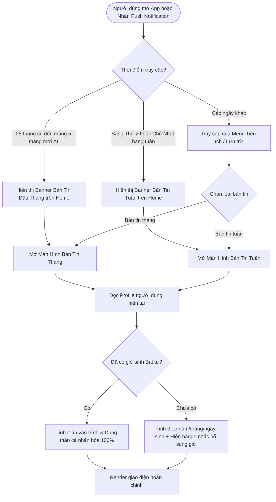
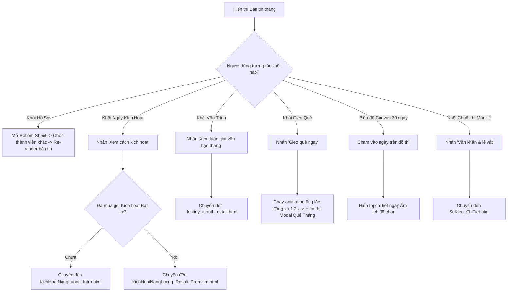

# BPRD: Hệ Thống Bản Tin Định Kỳ Tuần & Tháng (Bản Tin Tuần / Tháng)

> **Business and Product Requirements Document**
> Dự án: **Lịch Việt** (Mobile App - iOS & Android)
> Single Source of Truth cho: Business, Product, UI/UX Design, Engineering (Flutter/Backend), QA
> Nguồn nguyên mẫu: `prototype/BanTinDauThang.html` (Bản tin tháng) & `prototype/BanTinTuan.html` (Bản tin tuần)

---

## 1. Thông Tin Chung (Document Information)

- **Dự án / Tính năng**: Hệ thống Bản tin định kỳ Tuần & Tháng (Weekly & Monthly Personalized Digest)
- **Mã tài liệu**: `BPRD-003`
- **Mục tiêu chiến lược (Epic)**: Tăng mức độ gắn kết định kỳ (Retention Loop) theo nhịp thời gian tự nhiên của người Việt, tạo phễu chuyển đổi sang các dịch vụ phong thủy chuyên sâu ([[BPRD-001-KichHoatNangLuong]]).
- **Người chịu trách nhiệm (Owner)**: Đỗ Thị Hường (PO/PM)
- **Nhóm tham gia (Stakeholders)**: Product, Mobile Development (Flutter), Backend Engine, UI/UX Design, QA, Growth Marketing.
- **Mức độ ưu tiên (Priority)**: **P0 (Cao nhất)** - Trọng tâm phát hành quý này.
- **Chiến lược triển khai (Phasing Strategy)**:
  - 🚀 **Phase 1 (Triển khai trước)**: **Bản tin tháng (Bản tin đầu tháng)** – Tập trung vào nhu cầu tâm linh, khởi sự và lập kế hoạch cả tháng Âm lịch (`BanTinDauThang.html`).
  - 🔄 **Phase 2 (Triển khai tiếp nối)**: **Bản tin tuần (Weekly Digest)** – Tập trung vào việc điều phối nhịp sống, lịch 7 ngày và sắp xếp công việc ngắn hạn (`BanTinTuan.html`).

### Nhật ký thay đổi (Revision History)

| Ngày      | Phiên bản | Người thực hiện | Nội dung thay đổi                                                                                                                                                 |
| :--------- | :---------- | :------------------ | :------------------------------------------------------------------------------------------------------------------------------------------------------------------- |
| 2026-10-12 | v1.0        | Đỗ Thị Hường   | Khởi tạo tài liệu BPRD tổng thể theo chuẩn Business Analysis Standards, hợp nhất yêu cầu của cả Bản tin Tháng (Phase 1) và Bản tin Tuần (Phase 2). |

---

## 2. Tổng Quan Kinh Doanh (Business Context)

### 2.1. Vấn Đề và Cơ Hội (Problem & Opportunity)

#### Vấn đề của người dùng & sản phẩm hiện tại:

1. **Thiếu một "Bản đồ dẫn đường định kỳ"**: Người dùng mở Lịch Việt mỗi ngày thường chỉ xem ngày giờ tốt xấu trong 24 giờ. Họ thiếu một cái nhìn bao quát về cả tuần hoặc cả tháng sắp tới để chủ động lên kế hoạch lớn (ký hợp đồng, cưới hỏi, xuất hành, thắp hương cầu an).
2. **Nhu cầu tâm linh đầu tháng rất cao nhưng trải nghiệm bị phân mảnh**: Vào dịp Mùng 1 đầu tháng, người dùng cần: xem vận hạn tháng, tìm văn khấn, chọn giờ thắp hương, gieo quẻ cầu may, xem tiết khí. Hiện tại, những nội dung này phân tán ở 4-5 màn hình khác nhau, gây khó khăn cho việc tra cứu.
3. **Phễu Upsell chưa có "Điểm chạm tự nhiên" (Organic Touchpoint)**: Dịch vụ *Kích Hoạt Năng Lượng Bát Tự* ([[BPRD-001-KichHoatNangLuong]]) và *Luận giải vận hạn chuyên sâu* cần một kênh định kỳ nhắc nhở người dùng về các "thời điểm vàng" (ngày Quý Nhân, ngày Tài Lộc) để tăng tỷ lệ chuyển đổi trả phí (IAP).

#### Cơ hội kinh doanh (Opportunity):

1. **Tạo thói quen gắn kết theo chu kỳ (Habit Formation)**:
   - **Đầu tháng Âm lịch**: Người dùng mở Bản tin tháng để xem vận hạn, ngày tốt nhất tháng và văn khấn mùng 1.
   - **Đầu mỗi tuần (Thứ Hai)**: Người dùng mở Bản tin tuần để xem nhịp tuần (Đầu tuần - Giữa tuần - Cuối tuần) và lịch 7 ngày.
2. **Khai thác dữ liệu gia đình (Family Profile)**: Cho phép chuyển đổi nhanh để xem bản tin cho vợ/chồng, con cái, cha mẹ, biến Lịch Việt thành trợ lý gia đình.
3. **Thúc đẩy doanh thu In-App Purchase & Affiliate**: Dẫn luồng trực tiếp từ card "Thời điểm vàng kích hoạt năng lượng" và "Vận trình tháng" sang các gói luận giải chuyên sâu và vật phẩm phong thủy tương ứng.

### 2.2. Mục Tiêu và Chỉ Số Đo Lường (Business Goals & OKRs)

#### Khía cạnh Sản phẩm & Gắn kết:

- Tăng tỷ lệ người dùng quay lại hàng tháng (**Monthly Retention**) thêm **+15%**.
- Tăng chỉ số người dùng hoạt động hàng ngày/hàng tháng (**DAU/MAU ratio**) từ 0.32 lên **0.42**.
- Tỷ lệ hoàn thành đọc bản tin (Scroll Depth $\ge 80\%$) đạt trên **65%**.

#### Khía cạnh Kinh doanh & Chuyển đổi:

- Đóng góp tối thiểu **20%** lượng truy cập đầu vào cho phễu tính năng *Kích Hoạt Năng Lượng Cá Nhân*.
- Tăng tỷ lệ chuyển đổi IAP (In-App Purchase) từ bản tin đạt $\ge 2.5\%$.

#### Hệ thống KPIs phân tầng:

| Mã KPI       | Tên chỉ số                                              | Công thức / Định nghĩa                                                              | Mục tiêu (Target) | Chu kỳ đo        |
| :------------ | :--------------------------------------------------------- | :--------------------------------------------------------------------------------------- | :------------------ | :----------------- |
| **K01** | **Tỷ lệ mở Bản tin tháng (Monthly Open Rate)**  | (Unique Users xem Bản tin tháng / Active Users trong 5 ngày đầu tháng ÂL) × 100% | $\ge 35\%$        | Hàng tháng       |
| **K02** | **Tỷ lệ mở Bản tin tuần (Weekly Open Rate)**    | (Unique Users xem Bản tin tuần / Active Users Thứ 2 - Thứ 3) × 100%                 | $\ge 28\%$        | Hàng tuần        |
| **K03** | **Tỷ lệ hoàn thành đọc (Read Completion)**     | (Lượt cuộn đến khối cuối trang / Tổng lượt mở bản tin) × 100%               | $\ge 65\%$        | Hàng tuần/tháng |
| **K04** | **CTR Click CTA Kích Hoạt Năng Lượng**          | (Lượt click CTA "Xem cách kích hoạt" / Lượt xem card Kích hoạt) × 100%         | $\ge 18\%$        | Hàng ngày        |
| **K05** | **CTR Click Luận giải vận hạn**                  | (Lượt click "Xem luận giải vận hạn" / Lượt xem card Vận trình) × 100%         | $\ge 20\%$        | Hàng ngày        |
| **K06** | **Tỷ lệ tương tác Gieo quẻ đầu tháng**      | (Lượt click "Gieo quẻ ngay" / Lượt xem card Gieo quẻ) × 100%                      | $\ge 40\%$        | Hàng tháng       |
| **K07** | **Tỷ lệ đổi hồ sơ gia đình (Family Switch)** | (Số phiên đổi hồ sơ xem người thân / Tổng phiên đọc bản tin) × 100%       | $\ge 12\%$        | Hàng tháng       |
| **K08** | **Tỷ lệ chia sẻ bản tin (Viral Share)**          | (Lượt chia sẻ thành công / Tổng lượt đọc bản tin) × 100%                     | $\ge 5\%$         | Hàng tháng       |

### 2.3. Phạm Vi Triển Khai (Scope)

#### Nằm trong phạm vi (In-Scope):

```
┌─────────────────────────────────────────────────────────────────────────────┐
│                       HỆ THỐNG BẢN TIN ĐỊNH KỲ LỊCH VIỆT                    │
├──────────────────────────────────────┬──────────────────────────────────────┤
│    PHASE 1: BẢN TIN THÁNG (ƯU TIÊN)  │       PHASE 2: BẢN TIN TUẦN          │
│       (prototype/BanTinDauThang.html)│          (prototype/BanTinTuan.html) │
├──────────────────────────────────────┼──────────────────────────────────────┤
│ 1. Hero banner tháng mới (Thủy mặc)  │ 1. Hero banner tuần (Range ngày DL/ÂL)│
│ 2. Thanh chuyển đổi hồ sơ gia đình   │ 2. Khối 1: Tổng quan nhịp tuần       │
│ 3. Khối Ngày kích hoạt năng lượng    │    (Đầu tuần - Giữa tuần - Cuối tuần)│
│    (3 trạng thái: Quý nhân/Lộc/Cân bằng)│ 3. Khối 2: Lời khuyên đầu tuần       │
│ 4. Khối Vận trình tháng (4 chỉ số)   │ 4. Khối 3: Ngày cát & Ngày cần lưu ý │
│ 5. Khối Tử vi hôm nay (Snapshot)     │ 5. Khối 4: Sắp việc trong tuần       │
│ 6. Khối Gieo quẻ may mắn đầu tháng   │ 6. Khối 5: Lịch 7 ngày (Điểm số 1-100)│
│ 7. Khối Thời điểm đáng chú ý &       │ 7. Khối 6: Mốc Âm lịch đáng chú ý    │
│    Biểu đồ Canvas cuộn ngang 30 ngày │ 8. Khối 7: Điều cần chuẩn bị trước   │
│ 8. Khối Tiết khí thiên nhiên 3 mốc   │ 9. Khối 8: Nhìn trước tuần tới       │
│ 9. Khối Việc hợp tuổi sắp tới        │ 10. Khối 9: Khám phá tiện ích mở rộng│
│ 10. Khối Chuẩn bị Mùng 1 (Văn khấn)  │ 11. Footer: Lời chúc & Ấn triện tuần │
│ 11. Khối Lời nhắn đầu tháng          │                                      │
└──────────────────────────────────────┴──────────────────────────────────────┘
```

- **Hệ thống hạ tầng chung**:
  - Dữ liệu cá nhân hóa dựa trên Bát tự (Năm, Tháng, Ngày, Giờ sinh).
  - Tích hợp thông báo đẩy (Push Notification) điều hướng Deep-link thẳng vào bản tin.
  - Hỗ trợ lưu trữ offline (Local Cache Hive/SQLite) để đọc khi mất mạng.
  - Hệ thống Event Tracking đo lường phễu chuyển đổi toàn diện.

#### Nằm ngoài phạm vi (Out-of-Scope):

- Chức năng chỉnh sửa thông tin ngày giờ sinh trực tiếp trong trang bản tin (phải chuyển hướng sang màn hình Hồ sơ gia đình).
- Hệ thống thanh toán trực tiếp trên trang bản tin (chỉ đóng vai trò dẫn link / phễu chuyển đổi sang màn hình IAP tương ứng).

---

## 3. Người Dùng Mục Tiêu (User Personas & JTBD)

### 3.1. Chân Dung Người Dùng (Personas)

#### Persona 1: Chị Mai Lan (34 tuổi - Kinh doanh & Quản lý gia đình)

- **Hành vi**: Mở app Lịch Việt vào các ngày sóc, vọng (mùng 1, ngày rằm) và trước các sự kiện lớn. Chú trọng chuẩn bị ban thờ gia tiên, tìm bài cúng văn khấn chuẩn, muốn biết tháng này ngày nào tốt nhất để nhập hàng, ký kết.
- **Mong đợi**: Nhận một bản tin tóm gọn trong 2 phút, có đầy đủ từ tâm linh (văn khấn, giờ cúng) đến kế hoạch kinh doanh (ngày đẹp, việc hợp tuổi), và có thể xem nhanh cho cả chồng con.

#### Persona 2: Anh Đức Huy (28 tuổi - Trưởng nhóm công nghệ / Tri thức trẻ)

- **Hành vi**: Yêu thích phong thủy ứng dụng khoa học, xem tử vi để định hướng phát triển bản thân và điều tiết áp lực công việc. Thích các trải nghiệm tương tác trực quan như biểu đồ năng lượng, gieo quẻ đầu tháng.
- **Mong đợi**: Giao diện hiện đại, tinh tế, không mang màu sắc mê tín dị đoan. Thích biết trước các thời điểm gặp Quý Nhân hỗ trợ hoặc nhịp năng lượng trong tuần để phân bổ công việc hiệu quả.

### 3.2. Jobs-to-be-Done (JTBD)

1. **JTBD 1 (Bao quát tháng mới - Monthly)**: *Khi bước sang tháng mới Âm lịch, tôi muốn nhận được một bản tổng hợp cá nhân hóa về vận trình, các ngày tốt nhất và ngày kiêng kỵ, để tôi chủ động sắp xếp công việc và tài chính an tâm nhất.*
2. **JTBD 2 (Đón nhận Quý Nhân & Tài Lộc - Activation)**: *Khi đọc bản tin tháng, tôi muốn biết chính xác ngày nào có quý nhân tương trợ hoặc vượng tài khí, để tôi chọn đúng thời điểm kích hoạt năng lượng và chớp lấy cơ hội.*
3. **JTBD 3 (Nghi lễ chu đáo - Spiritual)**: *Khi đến ngày Mùng 1 đầu tháng, tôi muốn có sẵn khung giờ thắp hương đẹp và bài văn khấn chuẩn xác, để tôi thực hiện nghi lễ thờ cúng tổ tiên chu đáo.*
4. **JTBD 4 (Điều phối tuần mới - Weekly)**: *Khi bắt đầu một tuần làm việc mới, tôi muốn biết nhịp tuần (khi nào nên tiến, khi nào nên giữ) và điểm số từng ngày trong 7 ngày tới, để tối ưu hóa năng suất làm việc của mình.*

---

## 4. Yêu Cầu Nghiệp Vụ (Business Requirements)

### 4.1. Quy Trình / Luồng Nghiệp Vụ (Process Flows)

#### A. Luồng Điều Hướng và Phân Phối Bản Tin Định Kỳ



#### B. Luồng Tương Tác Trong Bản Tin Tháng & Phễu Chuyển Đổi



### 4.2. Quy Tắc Kinh Doanh (Business Rules)

| Mã Rule        | Tên quy tắc                                                                        | Nội dung quy tắc chi tiết                                                                                                                                                                                                                                                                                                                                                                                                                                                                                                                                                                                                                                                                                                                                                                                                                                                                                                            |
| :-------------- | :----------------------------------------------------------------------------------- | :-------------------------------------------------------------------------------------------------------------------------------------------------------------------------------------------------------------------------------------------------------------------------------------------------------------------------------------------------------------------------------------------------------------------------------------------------------------------------------------------------------------------------------------------------------------------------------------------------------------------------------------------------------------------------------------------------------------------------------------------------------------------------------------------------------------------------------------------------------------------------------------------------------------------------------------- |
| **BR-01** | **Chu kỳ phân phối Bản tin Tháng**                                        | - Bản tin tháng mới tự động phát hành vào**00:00 ngày cuối cùng của tháng cũ Âm lịch** (trước Mùng 1 một ngày). Từ thời điểm này, card Bản tin tháng trên Trang chủ chuyển sang bản tin tháng mới và làm mới lịch sử hiển thị điểm nhấn (lịch sử lưu trên thiết bị).- Card Bản tin tháng hiển thị trên Trang chủ suốt tháng, vị trí so với card Hỏi đáp tử vi: từ ngày cuối tháng cũ đến hết **ngày 15 tháng mới Âm lịch** ở vị trí 1, từ **ngày 16 đến hết ngày áp chót của tháng** ở vị trí 2, trừ ngày có sự kiện đặc biệt (ngày chuyển tiết khí, ngày kích hoạt năng lượng, ngày tốt nhất tháng) thì ở vị trí 1.- Bản tin được lưu vào mục *Lưu trữ / Bản tin* để tra cứu.                                                                                                                                                                                                                                                                                                                                                                                                                                                                                                                                                                          |
| **BR-02** | **Chu kỳ phân phối Bản tin Tuần**                                         | - Bản tin tuần mới tự động phát hành vào**18:00 Chủ Nhật** (để chuẩn bị trước) và ưu tiên hiển thị trên Trang chủ đến hết **23:59 Thứ Ba**.- Mỗi tuần có 1 bản tin riêng biệt được đánh số tuần theo năm (vd: Tuần 38, 14/09 – 20/09/2026).                                                                                                                                                                                                                                                                                                                                                                                                                                                                                                                                                                                                                                     |
| **BR-03** | **Cá nhân hóa theo Bát tự & Profile**                                     | - Mọi chỉ số vận trình, việc hợp tuổi và ngày kích hoạt đều tính toán dựa trên ngày giờ sinh của hồ sơ được chọn.- Khi người dùng chuyển đổi sang thành viên khác trên thanh hồ sơ, hệ thống tức thời tính toán lại dữ liệu cho người đó mà không làm mới lại toàn bộ trang.                                                                                                                                                                                                                                                                                                                                                                                                                                                                                                                                                                                                 |
| **BR-04** | **Quy tắc hiển thị Khối Ngày kích hoạt (BanTinDauThang.html L892-941)** | Căn cứ vào thuật toán dụng thần Bát tự của người dùng trong tháng, tự động áp dụng 1 trong 3 template card:1. **Case 1 (Có 1 ngày kích hoạt trọng điểm)**: Hiển thị card đơn với badge *Thời điểm vàng trong tháng*, tiêu đề lớn (vd: *"Đón sự hỗ trợ từ Quý Nhân"*), ngày diễn ra, đếm ngược *"Còn X ngày"*, mô tả lợi ích và nút *"Xem cách kích hoạt"*.2. **Case 2 (Có nhiều cơ hội kích hoạt trong tháng)**: Hiển thị tiêu đề *"Tháng này có nhiều cơ hội dành cho bạn"*, hàng tag chủ đề (`tag-quynhan`, `tag-tailoc`, `tag-thienma`), hiển thị ngày kích hoạt gần nhất và đếm ngược.3. **Case 3 (Chỉ có ngày cân bằng)**: Hiển thị tiêu đề *"Thời điểm tốt để cân bằng năng lượng"*, ngày phù hợp gần nhất, đếm ngược và nút *"Xem cách cân bằng"*. |
| **BR-05** | **Quy tắc đồ thị đường Canvas 30 ngày**                                | - Biểu đồ thể hiện biến thiên chỉ số ngày tốt của toàn bộ tháng Âm lịch (29 ngày nếu tháng thiếu, 30 ngày nếu tháng đủ).- Trục tung Oy cố định bên trái (thang 0, 50, 100 điểm).- Vùng đồ thị cuộn ngang với mật độ 15 ngày/màn hình.- Điểm ngày "Hôm nay" được gắn badge xanh và bong bóng hiển thị chỉ số % ở đỉnh điểm.- Ngày đạt điểm cao nhất tháng (Peak day) được làm nổi bật.- Cho phép chạm vào bất kỳ điểm nào trên đồ thị để mở chi tiết ngày đó.                                                                                                                                                                                                                                                                                                                                                                           |
| **BR-06** | **Quy tắc tính năng Gieo quẻ đầu tháng**                                | - Mỗi hồ sơ người dùng được gieo 1 quẻ may mắn cho mỗi tháng Âm lịch.- Sau khi gieo, kết quả được lưu vào cơ sở dữ liệu. Nếu người dùng quay lại trong cùng tháng, nút chuyển sang trạng thái *"Xem lại quẻ tháng"* để đọc lại lời khuyên.                                                                                                                                                                                                                                                                                                                                                                                                                                                                                                                                                                                                                                             |
| **BR-07** | **Quy tắc Lịch 7 ngày trong tuần (Bản tin tuần)**                        | - Hiển thị 7 cột đại diện cho 7 ngày (T2 đến CN).- Mỗi cột hiển thị: Thứ, Ngày DL, Icon năng lượng, Điểm số đánh giá (thang 100), Nhãn trạng thái (*Rất tốt*, *Tốt*, *Khá tốt*, *Bình thường*, *Cần lưu ý*).- Chạm vào cột ngày nào thì highlight ngày đó và mở chi tiết ngày tương ứng.                                                                                                                                                                                                                                                                                                                                                                                                                                                                                                                                                                                |

---

## 5. Yêu Cầu Sản Phẩm / Tính Năng (Functional Requirements)

### Bảng Ma Trận Tính Năng (Feature Matrix): Bản Tin Tháng vs Bản Tin Tuần

| Thành phần giao diện                  |                      Bản Tin Tháng (Phase 1)                      |                        Bản Tin Tuần (Phase 2)                        | Nguồn tham chiếu Prototype                                   |
| :--------------------------------------- | :-----------------------------------------------------------------: | :--------------------------------------------------------------------: | :------------------------------------------------------------- |
| **Hero Banner**                    |   Thủy mặc mùng 1, tháng ÂL, can chi, số ngày, tiết khí   | Phong cảnh làng quê, khoảng ngày DL, tuần thứ mấy, câu slogan | `BanTinDauThang.html` L220-323`BanTinTuan.html` L251-306   |
| **Thanh đổi hồ sơ gia đình** |             Có (Xem cho bản thân và người thân)             |                    Có (Thừa hưởng từ Phase 1)                    | `BanTinDauThang.html` L324-400                               |
| **Khối Ngày kích hoạt**        |           Có (3 case: Quý nhân, Tài lộc, Cân bằng)           |                     Không (Dành cho cấp tháng)                     | `BanTinDauThang.html` L846-1102                              |
| **Vận trình / Nhịp điệu**     | Lưới 4 chỉ số (Công việc, Tài chính, Tình cảm, Gia đạo) |     Timeline 3 giai đoạn (Đầu tuần, Giữa tuần, Cuối tuần)     | `BanTinDauThang.html` L469-585`BanTinTuan.html` L414-498   |
| **Tử vi / Lời khuyên**          |         Tử vi hôm nay (Snapshot màu hợp, số may mắn)         |              Lời khuyên tuần & Thông điệp dẫn lối              | `BanTinDauThang.html` L598-672`BanTinTuan.html` L900-938   |
| **Tương tác Gieo quẻ**         |       Gieo quẻ may mắn đầu tháng (Lắc ống đồng & xu)       |                                 Không                                 | `BanTinDauThang.html` L673-774                               |
| **Biến thiên thời gian**        |                Đồ thị Canvas 30 ngày cuộn ngang                |           Lịch 7 ngày trực quan (7 cột kèm điểm số)           | `BanTinDauThang.html` L1178-1226`BanTinTuan.html` L633-695 |
| **Ngày đáng chú ý**           |          Ngày tốt nhất tháng, ngày tốt, ngày kiêng          |           Ngày thuận lợi nhất tuần, ngày cần lưu ý           | `BanTinDauThang.html` L776-844`BanTinTuan.html` L499-605   |
| **Sắp việc theo tuổi**          |                Việc hợp tuổi sắp tới (Timeline)                |         Sắp việc trong tuần (6 danh mục việc gắn ngày)         | `BanTinDauThang.html` L1227-1290`BanTinTuan.html` L606-632 |
| **Nhịp điệu thiên nhiên**     |      Tiết khí trong tháng (Đếm ngược + Timeline 3 mốc)      |         Mốc Âm lịch trong tuần (Rằm, mùng 1, tiết khí)         | `BanTinDauThang.html` L1291-1702`BanTinTuan.html` L696-769 |
| **Chuẩn bị tâm linh**           |    Chuẩn bị Mùng 1 (Văn khấn lễ vật & giờ thắp hương)    |               Điều cần chuẩn bị trước trong tuần               | `BanTinDauThang.html` L1703-1835`BanTinTuan.html` L770-819 |
| **Chân trang (Footer)**           |             Lời nhắn an lành đầu tháng & Hoa sen             |           Nhìn trước tuần tới & Ấn triện Lịch Việt           | `BanTinDauThang.html` L1836-1886`BanTinTuan.html` L820-938 |

---

### Bảng Chi Tiết User Stories & Acceptance Criteria

Mục này được viết theo chuẩn **INVEST** và định dạng **Bullet Checklist** (`[Điều kiện] + [Hành động] -> [Kết quả]`), bao quát Happy path, Negative path, và Edge cases.

| ID              | User Story (As a / I want / So that)                                                                                                                                                                                                   | Acceptance Criteria (Tiêu chí nghiệm thu chuẩn Bullet Checklist)                                                                                                                                                                                                                                                                                                                                                                                                                                                                                                                                                                                                                                                                                                                                                                                                                                                                                                                                                                                                                                                                                          |     Priority     |       Phase       |
| :-------------- | :------------------------------------------------------------------------------------------------------------------------------------------------------------------------------------------------------------------------------------- | :------------------------------------------------------------------------------------------------------------------------------------------------------------------------------------------------------------------------------------------------------------------------------------------------------------------------------------------------------------------------------------------------------------------------------------------------------------------------------------------------------------------------------------------------------------------------------------------------------------------------------------------------------------------------------------------------------------------------------------------------------------------------------------------------------------------------------------------------------------------------------------------------------------------------------------------------------------------------------------------------------------------------------------------------------------------------------------------------------------------------------------------------------------ | :--------------: | :---------------: |
| **US-01** | **Là** người dùng mở app dịp đầu tháng,**Tôi muốn** xem Hero Banner và chuyển đổi hồ sơ gia đình,**Để** tôi nắm thông tin tháng mới cho bản thân và người thân.                      | - [ ]**[Happy path - Hero]**: Khi mở Bản tin tháng, hệ thống hiển thị chính xác tên tháng ÂL, khoảng ngày DL, Can chi tháng, số ngày (29/30) và tiết khí đầu tháng trên nền tranh thủy mặc có scrim che mờ.- [ ] **[Happy path - Profile]**: Khi tải trang xong, thanh hồ sơ hiển thị avatar, tên người dùng, can chi năm sinh (badge vàng) và ngày giờ sinh.- [ ] **[Happy path - Đổi người]**: Khi chạm vào thanh hồ sơ $\rightarrow$ Mở bottom sheet chọn thành viên gia đình $\rightarrow$ Chọn 1 người $\rightarrow$ Hệ thống cập nhật lại toàn bộ dữ liệu bản tin theo lá số người vừa chọn mà không reload trang.- [ ] **[Negative path - Chưa có giờ sinh]**: Khi hồ sơ chưa có giờ sinh, hệ thống hiển thị badge nhỏ *"Chưa có giờ sinh - Bổ sung để xem chuẩn xác"* và tính toán theo ngày sinh.- [ ] **[Edge case - Chưa có người thân]**: Khi tài khoản chưa thêm thành viên nào, bottom sheet hiển thị nút *"Thêm thành viên gia đình +"* dẫn sang màn hình thêm hồ sơ. |  **High**  | **Phase 1** |
| **US-02** | **Là** người dùng quan tâm phong thủy,**Tôi muốn** biết thời điểm vàng kích hoạt năng lượng trong tháng,**Để** tôi đón nhận sự hỗ trợ từ Quý Nhân hoặc Tài Lộc.                    | - [ ]**[Happy path - Case Quý Nhân]**: Khi tháng có ngày đón Quý Nhân, card hiển thị badge *"Thời điểm vàng trong tháng"*, tiêu đề gradient *"Đón sự hỗ trợ từ Quý Nhân"*, ngày diễn ra, đếm ngược *"Còn X ngày"*, đoạn mô tả và nút *"Xem cách kích hoạt"*.- [ ] **[Happy path - Case Nhiều cơ hội]**: Khi tháng có từ 2 ngày kích hoạt, hiển thị các tag nhãn (`Quý Nhân`, `Tài Lộc`, `Thiên Mã`), ngày gần nhất và đếm ngược.- [ ] **[Happy path - Case Cân bằng]**: Khi cần cân bằng ngũ hành, card hiển thị *"Thời điểm tốt để cân bằng năng lượng"* và nút *"Xem cách cân bằng"*.- [ ] **[Action - Chuyển phễu]**: Khi nhấn nút CTA hoặc chạm vào card $\rightarrow$ Hệ thống điều hướng trực tiếp sang màn hình giới thiệu tính năng [[BPRD-001-KichHoatNangLuong]].- [ ] **[Edge case - Đã qua ngày kích hoạt]**: Khi ngày kích hoạt gần nhất đã trôi qua, hệ thống tự động nhảy sang mốc kích hoạt kế tiếp trong tháng (nếu còn).                                                |  **High**  | **Phase 1** |
| **US-03** | **Là** người dùng Lịch Việt,**Tôi muốn** đọc tóm tắt vận trình tháng và 4 chỉ số phương diện,**Để** tôi biết điểm thuận lợi và việc cần lưu ý trong tháng.                        | - [ ]**[Happy path - Badge & Tóm tắt]**: Tiêu đề hiển thị kèm badge đánh giá tổng quan (*Tháng tốt*, *Ổn định*, *Cần lưu ý*) và đoạn luận giải 25-40 từ súc tích.- [ ] **[Happy path - Lưới 4 chỉ số]**: Hiển thị lưới 4 thẻ: Công việc, Tài chính, Tình cảm, Gia đạo kèm icon và nhãn màu chuẩn (Xanh lá: Tốt, Đỏ: Cần lưu ý, Xanh đậm: Ổn định).- [ ] **[Action - Luận giải chi tiết]**: Khi nhấn link CTA *"Xem luận giải vận hạn tháng"* $\rightarrow$ Chuyển sang màn hình `destiny_month_detail.html`.- [ ] **[Negative path - Mất kết nối]**: Khi mất mạng, hiển thị dữ liệu đã cache từ lần mở trước, không để trống card.                                                                                                                                                                                                                                                                                                                                                                                          |  **High**  | **Phase 1** |
| **US-04** | **Là** người dùng yêu thích văn hóa tâm linh Á Đông,**Tôi muốn** tương tác gieo quẻ may mắn đầu tháng,**Để** nhận lời khuyên và thông điệp cát lành cho tháng mới.                | - [ ]**[Happy path - Giao diện]**: Card gieo quẻ hiển thị minh họa ống lắc đồng xe, 3 đồng xu cổ và nút *"Gieo quẻ ngay"* có hiệu ứng viền sáng nhấp nháy (pulse animation).- [ ] **[Happy path - Tương tác]**: Khi nhấn nút $\rightarrow$ Kích hoạt rung nhẹ điện thoại (Haptic feedback) và hiển thị animation lắc đồng xu trong 1.2s.- [ ] **[Happy path - Kết quả]**: Animation kết thúc $\rightarrow$ Mở modal hiển thị Tên quẻ (*Thượng Cát*, *Đại Cát*...), icon quẻ và lời giải luận ý nghĩa cho tháng mới.- [ ] **[Edge case - Đã gieo trong tháng]**: Khi người dùng đã gieo quẻ trong tháng này, nút đổi thành *"Xem lại quẻ tháng"* $\rightarrow$ Bấm vào mở lại kết quả quẻ đã gieo.- [ ] **[Negative path - Spam click]**: Vô hiệu hóa nút bấm trong khi animation đang chạy để tránh gửi request trùng lặp.                                                                                                                                                                                 | **Medium** | **Phase 1** |
| **US-05** | **Là** người dùng cần chọn ngày khởi sự,**Tôi muốn** xem các ngày tốt/kiêng và biểu đồ Canvas 30 ngày,**Để** tôi chọn được ngày giờ đẹp nhất trong tháng.                           | - [ ]**[Happy path - Ngày tốt nhất]**: Hiển thị card Ngày tốt nhất tháng kèm icon ⭐, ngày ÂL và điểm số nổi bật (vd: 92%). Chạm vào mở chi tiết ngày.- [ ] **[Happy path - Chip ngày]**: Danh sách chip *Các ngày tốt trong tháng* hiển thị ngày ÂL kèm badge chỉ số ngày tốt (%) tương ứng (vd: `05/7 · 78%`, `12/7 · 82%`, `18/7 · 92%`), và danh sách chip *Ngày kiêng việc trọng đại* cuộn ngang; chạm vào từng chip mở chi tiết ngày đó (hiển thị kèm điểm số nếu có).- [ ] **[Happy path - Biểu đồ Canvas]**: Biểu đồ đường vẽ đủ 29/30 ngày của tháng ÂL. Trục Oy cố định (0, 50, 100). Vùng đồ thị cuộn ngang mượt mà (15 ngày/màn).- [ ] **[Happy path - Highlight hôm nay]**: Ngày hôm nay có badge ngày xanh lá và bong bóng hiển thị % điểm số trên đỉnh điểm.- [ ] **[Action - Chạm điểm đồ thị]**: Chạm vào bất kỳ điểm nào trên đường biểu đồ $\rightarrow$ Mở popup chi tiết ngày tương ứng.                                                                                                                                                                                                                                            |  **High**  | **Phase 1** |
| **US-06** | **Là** người dùng chú trọng sinh hoạt thuận tự nhiên,**Tôi muốn** theo dõi nhịp tiết khí và các việc hợp tuổi,**Để** tôi điều hòa sức khỏe và làm việc thuận lợi.                  | - [ ]**[Happy path - Tiết khí sắp tới]**: Hiển thị tên tiết khí kế tiếp, hộp đếm ngược *"CÒN X NGÀY"*, ngày bắt đầu DL và 2 gạch đầu dòng đặc điểm nổi bật.- [ ] **[Happy path - Nhịp 3 mốc]**: Khung nhịp tiết khí hiển thị 3 mốc trên đường timeline nối liền (nét liền mốc hiện tại, nét đứt mốc tương lai) kèm icon và trạng thái.- [ ] **[Happy path - Việc hợp tuổi]**: Hiển thị timeline các ngày hợp tuổi gần nhất và các việc nên làm (Cầu tài, Gặp gỡ, Ký kết, Khai trương). Có link xem cả tháng.                                                                                                                                                                                                                                                                                                                                                                                                                                                                                                                                     | **Medium** | **Phase 1** |
| **US-07** | **Là** người phụ trách cúng lễ gia đình,**Tôi muốn** có sẵn bài văn khấn Mùng 1 và biết giờ thắp hương tốt,**Để** tôi chuẩn bị nghi lễ đầu tháng chu đáo và đúng giờ thiêng. | - [ ]**[Happy path - Khung gộp]**: Khung Mùng 1 hiển thị 2 phần ngăn cách bằng đường kẻ tinh tế.- [ ] **[Happy path - Văn khấn & Lễ vật]**: Hiển thị ảnh minh họa bàn thờ gia tiên tươi sáng (`mung1_altar_bright.png`), tiêu đề và phụ đề. Chạm vào $\rightarrow$ Điều hướng sang bài văn khấn chi tiết `SuKien_ChiTiet.html`.- [ ] **[Happy path - Giờ thắp hương]**: Hiển thị 2 khung giờ hoàng đạo đẹp nhất trong ngày Mùng 1 (vd: `07:00 – 09:00 Giờ Thìn`, `11:00 – 13:00 Giờ Ngọ`).                                                                                                                                                                                                                                                                                                                                                                                                                                                                                                                                                                       |  **High**  | **Phase 1** |
| **US-08** | **Là** người dùng mở app đầu tuần mới,**Tôi muốn** xem Bản tin tuần với tổng quan nhịp tuần 3 chặng,**Để** tôi biết khi nào nên đẩy mạnh công việc, khi nào nên chậm lại.           | - [ ]**[Happy path - Hero tuần]**: Hiển thị khoảng ngày DL (vd: 14/09 – 20/09/2026), ngày ÂL, câu slogan thư pháp ngắn gọn.- [ ] **[Happy path - Nhịp tuần]**: Khung Nhịp tuần thể hiện 3 mốc liên hoàn dọc: Đầu tuần (T2-T3: Khởi động nhẹ), Giữa tuần (T4-T5: Thuận lợi nhất), Cuối tuần (T6-CN: Nên chậm lại) kèm icon và pill trạng thái.- [ ] **[Happy path - Đánh giá chung]**: Badge trên đầu khối ghi rõ nhận định tuần (vd: *"Tuần khá thuận lợi"*).                                                                                                                                                                                                                                                                                                                                                                                                                                                                                                                                                                                                                 |  **High**  | **Phase 2** |
| **US-09** | **Là** người dùng cần lập kế hoạch 7 ngày,**Tôi muốn** xem Lịch 7 ngày trực quan với điểm số từng ngày,**Để** tôi chọn đúng ngày trong tuần cho từng mục tiêu công việc.            | - [ ]**[Happy path - 7 cột ngày]**: Khối Lịch tuần chia đều 7 cột cho 7 ngày từ T2 đến CN.- [ ] **[Happy path - Hiển thị từng cột]**: Mỗi cột hiển thị Thứ, Ngày DL, Icon đại diện, Điểm số vận khí (0-100), Nhãn trạng thái màu (*Rất tốt*, *Khá tốt*, *Bình thường*, *Cần lưu ý*).- [ ] **[Action - Chạm ngày]**: Chạm vào ngày nào thì cột đó đổi viền active và mở popup xem chi tiết ngày đó.- [ ] **[Action - Nút xem chi tiết]**: Nút *"Xem chi tiết từng ngày"* dẫn sang màn hình Lịch tuần chi tiết.                                                                                                                                                                                                                                                                                                                                                                                                                                                                                                                                    |  **High**  | **Phase 2** |
| **US-10** | **Là** người dùng bận rộn,**Tôi muốn** xem khối Sắp việc trong tuần theo tuổi của mình,**Để** tôi biết ngày nào hợp nhất cho các công việc cụ thể.                                       | - [ ]**[Happy path - Danh mục việc]**: Hiển thị danh sách các việc phổ biến: Gặp gỡ trao đổi, Ký kết hợp đồng, Cầu tài giao dịch, Xuất hành đi xa, Mua sắm lớn, Việc gia đình.- [ ] **[Happy path - Gợi ý ngày]**: Mỗi công việc hiển thị rõ Thứ và Ngày phù hợp nhất trong tuần (vd: Ký kết hợp đồng $\rightarrow$ Thứ Năm 17/09).- [ ] **[Action - Chạm vào việc]**: Chạm vào từng dòng $\rightarrow$ Mở màn hình lọc các ngày tốt cho công việc đó trong tuần.                                                                                                                                                                                                                                                                                                                                                                                                                                                                                                                                                                                                |  **High**  | **Phase 2** |
| **US-11** | **Là** người dùng chuẩn bị cho tuần mới,**Tôi muốn** biết các mốc Âm lịch và điều cần chuẩn bị trước,**Để** tôi không bỏ lỡ các dịp cúng lễ và chủ động chuẩn bị đồ đạc.  | - [ ]**[Happy path - Mốc Âm lịch]**: Hiển thị card sự kiện đặc biệt trong tuần (vd: Rằm tháng Tám, Tiết khí Bạch Lộ) kèm ảnh nền, mô tả và nút xem hướng dẫn chi tiết.- [ ] **[Happy path - Điều cần chuẩn bị]**: Hiển thị các gợi ý chuẩn bị trước (vd: Cuối tuần có ngày đẹp xuất hành $\rightarrow$ nên lên kế hoạch từ đầu tuần).                                                                                                                                                                                                                                                                                                                                                                                                                                                                                                                                                                                                                                                                                                                                                | **Medium** | **Phase 2** |

---

### 5.1. UX/UI & Trải Nghiệm (Mockups & Design Tokens)

- **File nguyên mẫu tương tác**:
  - Bản tin tháng: [BanTinDauThang.html](file:///Users/dohuong/Desktop/Lich_Viet/prototype/BanTinDauThang.html)
  - Bản tin tuần: [BanTinTuan.html](file:///Users/dohuong/Desktop/Lich_Viet/prototype/BanTinTuan.html)
- **Design Tokens chính**:
  - *Màu chủ đạo (Primary)*: Xanh trầm Lịch Việt `#1B4D3E`, Xanh lá tự nhiên `#2D6A4F`.
  - *Màu tài lộc / Vàng hoàng kim (Accent Gold)*: Vàng hổ phách `#D97706`, Nền kem vàng `#FFFBEB`, Viền vàng `#FDE68A`.
  - *Màu Quý Nhân*: Nền tím nhạt `#EDE9FE`, Chữ tím `#6D28D9`.
  - *Màu cảnh báo (Warning)*: Nền đỏ nhạt `#FEF2F2`, Chữ đỏ `#DC2626`.
  - *Typography*: Plus Jakarta Sans cho số lining-nums (`font-feature-settings: "lnum" 1`) và Playfair Display / Noto Serif cho tiêu đề trang trọng Á Đông.
- **Trạng thái giao diện (UI States)**:
  - *Loading State*: Skeleton loading mềm mại dạng shimmer cho từng khối card trong khi chờ tải dữ liệu Bát tự.
  - *Empty / Guest State*: Người dùng chưa đăng nhập hoặc chưa nhập giờ sinh vẫn xem được bản tin tổng quát, có thanh CTA khuyến khích đăng nhập để cá nhân hóa 100%.
  - *Offline State*: Hiển thị dữ liệu đã lưu trong cache cục bộ kèm banner nhẹ: *"Bạn đang xem dữ liệu bản tin đã lưu ngoại tuyến"*.

---

## 6. Yêu Cầu Phi Chức Năng (Non-Functional Requirements)

### 6.1. Hiệu Năng & Tối Ưu (Performance)

- **Thời gian tải trang (Load Time)**: Thời gian hiển thị bản tin (First Contentful Paint) < **1.2 giây** trên mạng 4G/Wifi tiêu chuẩn.
- **Tần số quét biểu đồ Canvas**: Biểu đồ Canvas 30 ngày phải render đạt **60 FPS** ổn định trên các dòng máy Android/iOS tầm trung, không gây giật khi vuốt cuộn ngang.
- **Dung lượng payload API**: Dữ liệu JSON của 1 bản tin tháng hoặc tuần cho 1 profile không vượt quá **45 KB**.

### 6.2. Bộ Nhớ Đệm & Khả Năng Ngoại Tuyến (Offline & Caching)

- Toàn bộ bản tin tháng và tuần sau khi tải về phải được lưu trữ vào Local Database (Hive / SQLite).
- Khi người dùng không có Internet, app tự động mở bản tin đã lưu gần nhất để người dùng luôn có thông tin tra cứu.

### 6.3. Bảo Mật & Quyền Riêng Tư (Security & Privacy)

- Mã hóa toàn bộ thông tin cá nhân (Họ tên, ngày giờ sinh) khi gửi lên API bằng giao thức **HTTPS (TLS 1.3)**.
- Dữ liệu lá số và thông tin gia đình của người dùng không được lưu cache ở các proxy công cộng.

### 6.4. Tính Tương Thích (Compatibility)

- Hỗ trợ đầy đủ trên hệ điều hành **iOS 13.0+** và **Android 8.0 (API 26)+**.
- Hỗ trợ tốt giao diện màn hình khuyết tật (Tai thỏ, Dynamic Island, Đục lỗ) thông qua SafeArea của Flutter.

---

## 7. Edge Cases (Trường Hợp Ngoại Lệ & Xử Lý Lỗi)

1. **Người dùng mở bản tin vào giữa tháng (sau ngày mùng 5)**:
   - Bản tin vẫn hiển thị đầy đủ thông tin tháng đó, nhưng điểm ngày "Hôm nay" trên biểu đồ Canvas tự động trỏ đến ngày hiện tại. Khối ngày kích hoạt tự động ẩn các ngày đã qua và hiển thị ngày kích hoạt tiếp theo gần nhất.
2. **Tháng Âm lịch có tháng nhuận (Leap Lunar Month)**:
   - Dữ liệu hiển thị rõ: *"Tháng [X] nhuận Âm lịch"*.
   - Thuật toán tiết khí và can chi ngày giờ được tính toán chính xác theo công thức Lịch thiên văn Việt Nam.
3. **Tháng thiếu (chỉ có 29 ngày Âm lịch)**:
   - Biểu đồ Canvas tự động co giãn hiển thị đúng 29 điểm, không vẽ điểm ngày 30 ảo.
4. **Người dùng bấm liên tục vào nút Gieo quẻ (Spamming)**:
   - Vô hiệu hóa nút bấm (Disable click) trong suốt quá trình chạy animation (1.2 giây).
5. **Hồ sơ chưa có giờ sinh chính xác**:
   - Vẫn hiển thị bản tin dựa trên ngày/tháng/năm sinh. Thêm nút nhắc nhở: *"Bổ sung giờ sinh để kết quả chuẩn xác 100%"*.

---

## 8. Kế Hoạch Ra Mắt & Go-to-Market (GTM)

### 8.1. Lộ Trình Triển Khai (Phasing)

- **Giai đoạn 1: Triển khai Bản Tin Tháng (Phase 1 - Hiện tại)**
  - *Sprint 1 - 2 (3 tuần)*: Lập trình giao diện Flutter cho Bản tin tháng dựa trên `BanTinDauThang.html`, kết nối API tính toán Bát tự và vẽ biểu đồ Canvas.
  - *Sprint 3 (1 tuần)*: Kiểm thử nội bộ (Alpha test) và thử nghiệm Beta cho 15% người dùng.
  - *Phát hành chính thức (Rollout 100%)*: Ra mắt vào ngày cuối cùng của tháng Âm lịch kế tiếp.
- **Giai đoạn 2: Triển khai Bản Tin Tuần (Phase 2 - Tiếp nối)**
  - *Sprint 4 - 5 (3 tuần)*: Lập trình giao diện Bản tin tuần dựa trên `BanTinTuan.html` và cơ chế phân phối tự động mỗi Chủ Nhật / Thứ Hai.
  - *Phát hành chính thức*: Ra mắt bản tin tuần sau khi bản tin tháng đã vận hành ổn định qua 2 chu kỳ tháng.

### 8.2. Chiến Dịch Thông Báo Đẩy (Push Notification Strategy)

- Tham chiếu theo [[BRD-001-PushNotificationCaNhanHoa]]:
  - **Thông báo Bản tin tháng 1**: Bắn vào **07:30 sáng ngày cuối cùng của tháng cũ ÂL** – *"Tháng mới sắp sang! Mở Bản tin đầu tháng xem vận trình và giờ đẹp thắp hương rước lộc."*
  - **Thông báo Bản tin tháng 2**: Bắn vào **07:00 sáng ngày Mùng 1 ÂL** – *"Hôm nay Mùng 1! Xem ngay giờ đẹp thắp hương và bài văn khấn chuẩn đón may mắn."*
  - **Thông báo Bản tin tuần**: Bắn vào **07:30 sáng Thứ Hai hàng tuần** – *"Tuần mới khởi sắc! Xem lịch 7 ngày và nhịp tuần để sắp việc hanh thông."*

---

## 9. Definition of Done (Tiêu Chí Nghiệm Thu Toàn Diện)

- [ ] Tài liệu BPRD-003 được phê duyệt bởi Product Owner, Tech Lead Flutter và Lead Backend.
- [ ] Giao diện Flutter khớp 100% với nguyên mẫu `prototype/BanTinDauThang.html` (Bản tin tháng) và sẵn sàng cấu trúc cho `prototype/BanTinTuan.html` (Bản tin tuần).
- [ ] Hoàn thành toàn bộ Acceptance Criteria của 7 User Stories Phase 1 (US-01 đến US-07).
- [ ] Khối Ngày kích hoạt năng lượng hiển thị chuẩn xác 3 template card theo đúng logic Bát tự (Quý Nhân, Nhiều cơ hội, Cân bằng).
- [ ] Biểu đồ Canvas 30 ngày cuộn ngang mượt mà, đạt 60 FPS trên thiết bị di động thử nghiệm.
- [ ] Tính năng đổi thành viên gia đình hoạt động chính xác, dữ liệu cập nhật tức thời theo lá số người được chọn.
- [ ] Đầy đủ 10 sự kiện tracking analytics trên Firebase / Amplitude để đo lường phễu chuyển đổi.
- [ ] Pass 100% các kịch bản kiểm thử ngoại lệ (offline, chưa có giờ sinh, tháng nhuận, spam gieo quẻ).
- [ ] Cập nhật đồng bộ vào mục lục tài liệu dự án tại `docs/020-Requirements/Requirements-MOC.md` và `docs/000-Index.md`.
