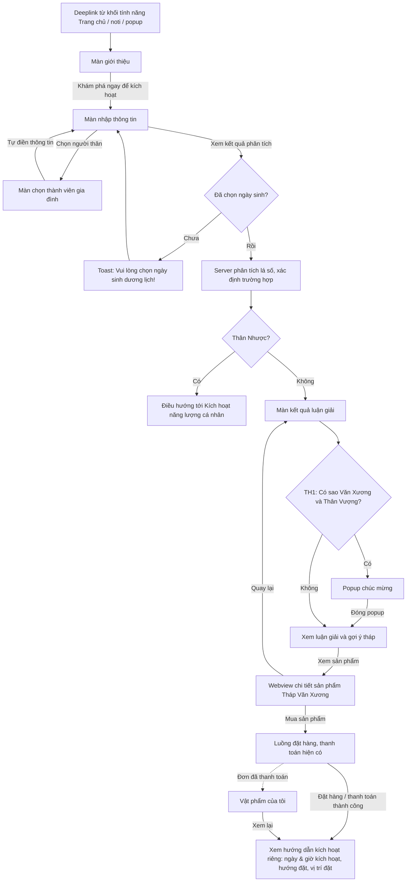

# BPRD: Kích Hoạt Trí Tuệ & Công Danh (Tháp Văn Xương)

> Business and Product Requirements Document

## 1. Thông tin tài liệu

| **Trường**  | **Nội dung**                                                                |
| ------------------- | ---------------------------------------------------------------------------------- |
| Tên dự án        | Kích Hoạt Trí Tuệ & Công Danh (kích hoạt học tập với Tháp Văn Xương) |
| Người phụ trách | Đỗ Thị Hường                                                                  |
| Phiên bản         | v1.1                                                                               |
| Trạng thái        | Bản nháp                                                                         |
| Nhóm tham gia      | Product, Design, Dev (App, Backend), QA, Nội dung phong thủy, Thương mại      |
| Mức độ ưu tiên | Cao                                                                                |

## Nhật ký thay đổi

| Ngày cập nhật | Phiên bản | Người thực hiện | Nội dung thay đổi                                                                                                                                                                                                                                                         |
| ---------------- | ----------- | ------------------- | ---------------------------------------------------------------------------------------------------------------------------------------------------------------------------------------------------------------------------------------------------------------------------- |
| 2026-10-27       | v1.0        | Đỗ Thị Hường   | Khởi tạo tài liệu dựa trên [[Story-KichHoatHocTap]]                                                                                                                                                                                                                                            |
| 2026-10-27       | v1.1        | Đỗ Thị Hường   | Bổ sung điểm vào tính năng, quyền xem khi chưa đăng nhập, mốc tuổi, gộp TH3/TH4 thành trường hợp Thân Nhược, ẩn khối sản phẩm khi không có gợi ý, hướng dẫn kích hoạt sau khi đặt hàng/thanh toán và xem lại ở Vật phẩm của tôi |

---

## 2. Tổng quan kinh doanh (Business Context)

### 2.1. Vấn đề và cơ hội

- **Vấn đề**: Phụ huynh và người đang đi học, đi làm quan tâm tới việc học tập, thi cử và thăng tiến, nhưng chưa có công cụ cá nhân hóa giúp họ biết bản thân hoặc con có lợi thế về học hỏi theo Bát tự hay không, và nên chọn vật phẩm hỗ trợ nào cho phù hợp.
- **Cơ hội**:
  - Tái sử dụng nền tảng lập lá số Bát tự của tính năng Kích hoạt năng lượng cá nhân để ra mắt nhanh một tính năng mới theo chủ đề học tập, công danh.
  - Mở thêm kênh bán Tháp Văn Xương có kèm hướng dẫn kích hoạt riêng theo lá số. Đây là điểm khác biệt so với việc mua tháp ở nơi khác.
  - Nhắm tới tập phụ huynh: một người dùng có thể xem cho nhiều thành viên trong gia đình, tăng số lá số lập và số cơ hội gợi ý sản phẩm.

### 2.2. Mục tiêu và KPIs

**Mục tiêu kinh doanh:**

- Tăng doanh thu bán sản phẩm Tháp Văn Xương qua gợi ý cá nhân hóa theo lá số.

**Mục tiêu sản phẩm:**

- Giúp người dùng biết lá số có sao Văn Xương hay không, trạng thái Thân Vượng/Thân Nhược và ý nghĩa với việc học tập, công danh.
- Gợi ý Tháp Văn Xương có màu sắc, chất liệu phù hợp với lá số và dẫn người dùng tới trang sản phẩm.

**KPIs cốt lõi** (mục tiêu là đề xuất, cần xác nhận):

| **Mã** | **Chỉ số**                           | **Định nghĩa / Cách tính**                                                                | **Mục tiêu**               | **Tần suất đo** |
| :------------ | :------------------------------------------- | :--------------------------------------------------------------------------------------------------- | :--------------------------------- | :----------------------- |
| **K01** | Số lá số Văn Xương hoàn thành/ngày  | Đếm sự kiện `khht_result_viewed` trong ngày                                                   | Đặt baseline tháng đầu        | Hàng ngày              |
| **K02** | Tỷ lệ nhấp "Xem sản phẩm"               | (Số lượt xem màn kết quả có nhấp "Xem sản phẩm" / Tổng lượt xem màn kết quả) × 100% | Đặt baseline tháng đầu        | Hàng ngày              |
| **K03** | Số đơn hàng Tháp Văn Xương           | Tổng số đơn khởi tạo có sản phẩm Tháp Văn Xương đến từ tính năng này              | Đặt baseline tháng đầu        | Hàng tuần              |
| **K04** | Doanh thu Tháp Văn Xương từ tính năng | Tổng doanh thu các đơn Tháp Văn Xương thành công đến từ tính năng này                | Đặt baseline; tăng trưởng MoM | Hàng tháng             |

### 2.2.1. Phễu chuyển đổi

| **Bước phễu**                     | **Sự kiện đo**    | **Chỉ số theo dõi** |
| :----------------------------------------- | :------------------------- | :--------------------------- |
| 1. Xem màn giới thiệu                   | `khht_intro_viewed`      | Đầu phễu                  |
| 2. Bấm "Khám phá ngay để kích hoạt" | `khht_intro_cta_clicked` | Intro → Input CVR           |
| 3. Xem màn kết quả                      | `khht_result_viewed`     | Input → Result CVR          |
| 4. Bấm "Xem sản phẩm"                   | `khht_product_clicked`   | Result → Product CVR        |
| 5. Tạo đơn hàng                        | `khht_order_created`     | Product → Order CVR         |

### 2.2.2. Chỉ số gắn kết

| **Mã** | **Chỉ số**                             | **Định nghĩa**                                                                             | **Mục tiêu** |
| :------------ | :--------------------------------------------- | :-------------------------------------------------------------------------------------------------- | :------------------- |
| **E01** | Phân bổ lá số theo trường hợp           | Tỷ lệ lá số thuộc TH1, TH2, Thân Nhược                                                      | Theo dõi            |
| **E05** | Tỷ lệ chuyển sang Kích hoạt năng lượng | % lá số Thân Nhược được điều hướng sang tính năng Kích hoạt năng lượng cá nhân | Đặt baseline       |
| **E02** | Tỷ lệ xem cho người thân                  | % lá số được lập qua "Chọn người thân"                                                     | Đặt baseline       |
| **E03** | Lá số bình quân/người dùng              | Tổng lá số lập / Số người dùng duy nhất                                                    | Đặt baseline       |
| **E04** | Lượt nhấp theo từng sản phẩm             | Số lượt nhấp "Xem sản phẩm", tách theo `product_id` và trường hợp                      | Đặt baseline       |

> **Ghi chú phân tích**: Các chỉ số cần tách theo nền tảng (iOS/Android), trạng thái đăng nhập, trường hợp lá số (TH1, TH2, Thân Nhược) và nhóm tuổi người được xem (người lớn/trẻ em).

### 2.3. Phạm vi (Scope)

**Nằm trong phạm vi:**

- Điểm vào tính năng: deeplink, có thể gắn vào khối tính năng ở Trang chủ, thông báo đẩy (noti) và popup.
- Màn giới thiệu với nội dung cố định trong ứng dụng.
- Màn nhập thông tin, dùng chung logic với Kích hoạt năng lượng cá nhân (có chọn thành viên gia đình).
- Màn kết quả luận giải cho trường hợp Thân Vượng (TH1, TH2), gồm:
  - lá số Bát tự có hàng thần sát;
  - biểu đồ Ngũ hành;
  - khối Can ngày;
  - ý nghĩa đặt tháp;
  - gợi ý chọn tháp;
  - danh sách sản phẩm gợi ý.
- Popup chúc mừng khi lá số có sao Văn Xương và Thân Vượng.
- Màn chi tiết sản phẩm Tháp Văn Xương (webview, dùng chung màn chi tiết sản phẩm của Kích hoạt năng lượng). Đặt hàng hoặc thanh toán thành công → người dùng xem được hướng dẫn kích hoạt riêng (ngày & giờ kích hoạt, hướng đặt, vị trí đặt) theo kết quả tra cứu. Đơn đã thanh toán → xem lại hướng dẫn ở mục Vật phẩm của tôi.

**Nằm ngoài phạm vi:**

- Phân quyền Free/Premium hoặc thanh toán in-app cho nội dung luận giải. Toàn bộ nội dung xem miễn phí.
- Luồng đặt hàng, thanh toán sản phẩm. Phần này dùng luồng mua sắm hiện có.

---

## 3. Người dùng mục tiêu (User Personas & JTBD)

### 3.1. Chân dung người dùng

- **Persona 1: Chị Lan (38 tuổi, phụ huynh có con đang đi học)**
  - *Đặc điểm*: Quan tâm việc học, thi cử của con. Tin vào phong thủy ở mức tham khảo.
  - *Hành vi*: Xem cho con và các thành viên trong nhà. Sẵn sàng mua vật phẩm phong thủy cho góc học tập của con nếu thấy phù hợp với lá số.
- **Persona 2: Anh Nam (27 tuổi, nhân viên văn phòng)**
  - *Đặc điểm*: Đang học thêm chứng chỉ, muốn thăng tiến trong công việc.
  - *Hành vi*: Muốn biết thế mạnh học hỏi, diễn đạt của bản thân, đọc luận giải ngắn gọn, có thể mua tháp đặt ở bàn làm việc.

### 3.2. Jobs-to-be-Done

- **JTBD 1**: Khi con sắp bước vào kỳ thi, tôi muốn biết lá số của con có sao Văn Xương hay không và nên đặt tháp gì, để hỗ trợ con tập trung và tự tin hơn khi học.
- **JTBD 2**: Khi muốn phát triển sự nghiệp, tôi muốn hiểu thế mạnh học hỏi, tư duy của bản thân theo Bát tự, để chọn vật phẩm phù hợp đặt ở nơi làm việc.

---

## 4. Yêu cầu nghiệp vụ (Business Requirements)

### 4.1. Luồng nghiệp vụ

### 4.2. Phân loại trường hợp lá số

| Trường hợp | Sao Văn Xương | Trạng thái thân | Hướng xử lý                                                                                   |
| ------------- | ---------------- | ------------------ | ------------------------------------------------------------------------------------------------- |
| TH1           | Có              | Thân Vượng      | Luận giải Văn Xương, gợi ý tháp theo hành của Thập thần, hiển thị popup chúc mừng |
| TH2           | Không có       | Thân Vượng      | Luận giải Văn Xương, gợi ý tháp theo hành của Thập thần                               |
| Thân Nhược | Có hoặc không | Thân Nhược      | Điều hướng tới tính năng Kích hoạt năng lượng cá nhân ([[BPRD-001-KichHoatNangLuong]])                            |

> Cách điều hướng cụ thể cho trường hợp Thân Nhược đang chờ xác nhận (xem câu hỏi mở).

### 4.3. Quy tắc kinh doanh (Business Rules)

- **BR-1 (Miễn phí, không bắt buộc đăng nhập)**: Màn kết quả không phân quyền Free/Premium. Mọi người dùng, kể cả chưa đăng nhập, đều xem được toàn bộ nội dung luận giải và gợi ý sản phẩm.
- **BR-2 (Dữ liệu đầu vào)**: Ngày sinh dương lịch là bắt buộc. Giờ sinh không bắt buộc nhưng được khuyến nghị. Lần đầu vào màn nhập thông tin, form tự điền thông tin của người dùng. Từ lần sau, form hiển thị thông tin xem gần nhất.
- **BR-3 (Xem cho người thân)**: Thông tin tự điền từ "Chọn người thân" được sửa tự do trước khi xem kết quả. Phần sửa không cập nhật vào hồ sơ thành viên.
- **BR-4 (Hiển thị sao Văn Xương)**: Sao Văn Xương hiển thị ở hàng thần sát của tất cả các trụ chứa sao. Nội dung luận giải nhắc tới trụ cũng điền đúng các trụ chứa sao trên lá số.
- **BR-5 (Popup chúc mừng)**:
  - Popup chỉ hiển thị với TH1.
  - Tỷ lệ "Bạn thuộc nhóm X%" là phần trăm người có sao Văn Xương trên tổng người dùng Lịch Việt (tính tương đối).
- **BR-6 (Nguồn nội dung luận giải)**:
  - Toàn bộ nội dung trên màn kết quả do server trả về theo lá số, ứng dụng không fix cứng câu chữ. Phạm vi gồm khối tổng kết, khối Can ngày, ý nghĩa đặt tháp, gợi ý chọn tháp và sản phẩm.
  - Nội dung màn giới thiệu và khối "Dành riêng cho bạn" ở màn chi tiết sản phẩm Tháp Văn Xương là nội dung cố định.
- **BR-7 (Ý nghĩa đặt tháp)**:
  - Nội dung khối ý nghĩa đặt tháp phụ thuộc 3 yếu tố: trường hợp lá số, Nhật chủ (Giáp, Ất, …) và nhóm tuổi người được xem.
  - Nhóm tuổi: dưới 18 tuổi là trẻ em, từ 18 tuổi trở lên là người lớn.
  - Nguồn dữ liệu: sheet `TH THÂN VƯỢNG - NHƯỢC` trong file [THÁP VĂN XƯƠNG](https://docs.google.com/spreadsheets/d/1diRZnsMM4shJ0fecRM9RWTQ6rDHP4MEPH_uQaYpyv-8/edit?usp=sharing).
- **BR-8 (Gợi ý tháp)**:
  - Thân Vượng chọn tháp theo hành của Thập thần.
  - Màu tháp và danh sách sản phẩm gợi ý tương ứng với hành đó.
  - Gợi ý không phụ thuộc nhóm tuổi.
  - Số mẫu tháp nhắc tới trong câu gợi ý khớp với số sản phẩm hiển thị.
  - Server không trả về sản phẩm gợi ý → không hiển thị khối danh sách sản phẩm.

---

## 5. Đặc tả tính năng cốt lõi

| **Mã** | **Tính năng**                        | **Mô tả**                                                                                                                                                                                                                                                                                                   | **User Story** | **Giai đoạn** | **Trạng thái** |
| :------------ | :------------------------------------------- | :------------------------------------------------------------------------------------------------------------------------------------------------------------------------------------------------------------------------------------------------------------------------------------------------------------------ | :------------------- | :-------------------- | :--------------------- |
| **F01** | Màn giới thiệu                            | Giới thiệu sao Văn Xương, Thân Vượng và 5 lợi ích đặt Tháp Văn Xương. CTA ghim cố định đáy màn.                                                                                                                                                                                              | [[Story-KichHoatHocTap#US-KHHT-01 - Xem giới thiệu tính năng Kích hoạt Trí tuệ & Công danh]]                     | GD1                   | Đang phân tích      |
| **F02** | Màn nhập thông tin                        | Nhập hoặc chọn nhanh thông tin thành viên, hiển thị Can Chi và Mệnh theo ngày sinh.                                                                                                                                                                                                                      | [[Story-KichHoatHocTap#US-KHHT-02 - Nhập thông tin để khám phá Văn Xương]]                     | GD1                   | Đang phân tích      |
| **F03** | Popup chúc mừng                            | Hiển thị khi lá số thuộc TH1, kèm tỷ lệ người dùng có sao Văn Xương.                                                                                                                                                                                                                                 | [[Story-KichHoatHocTap#US-KHHT-03 - Popup chúc mừng khi lá số có sao Văn Xương và Thân Vượng]]                     | GD1                   | Đang phân tích      |
| **F04** | Màn kết quả luận giải                   | Lá số Bát tự, biểu đồ Ngũ hành, khối Can ngày, ý nghĩa đặt tháp, gợi ý chọn tháp và sản phẩm theo TH1, TH2. Lá số Thân Nhược điều hướng tới Kích hoạt năng lượng cá nhân.                                                                                                   | [[Story-KichHoatHocTap#US-KHHT-04 - Xem kết quả luận giải Văn Xương theo lá số Bát tự]]                     | GD1                   | Đang phân tích      |
| **F05** | Màn chi tiết sản phẩm Tháp Văn Xương | Webview chi tiết sản phẩm, dùng chung màn của Kích hoạt năng lượng, có khối nội dung cố định cho dòng Tháp Văn Xương. Đặt hàng hoặc thanh toán thành công → xem hướng dẫn kích hoạt riêng theo kết quả tra cứu, xem lại ở Vật phẩm của tôi khi đơn đã thanh toán. | [[Story-KichHoatHocTap#US-KHHT-05 - Xem chi tiết sản phẩm Tháp Văn Xương]]                     | GD1                   | Đang phân tích      |

---

## 6. Thiết kế

| Màn hình            | Thiết kế                                                           | User Story |
| --------------------- | -------------------------------------------------------------------- | ---------- |
| Giới thiệu          | Ảnh thiết kế màn 1 (cập nhật link Figma)                       | US-KHHT-01 |
| Nhập thông tin      | Ảnh thiết kế màn 2 (cập nhật link Figma)                       | US-KHHT-02 |
| Popup chúc mừng     | Ảnh thiết kế màn 3 (cập nhật link Figma)                       | US-KHHT-03 |
| Kết quả luận giải | Ảnh thiết kế TH1, TH2 (cập nhật link Figma)                     | US-KHHT-04 |
| Chi tiết sản phẩm  | Dùng chung màn chi tiết sản phẩm của Kích hoạt năng lượng | US-KHHT-05 |

---

## 7. Yêu cầu phi chức năng

- **Hiệu năng**: Màn kết quả hiển thị đầy đủ nội dung trong vòng 2 giây (P95) sau khi bấm "Xem kết quả phân tích" (đề xuất, cần xác nhận với Dev).
- **Vận hành nội dung**: Nội dung luận giải và danh sách sản phẩm gợi ý cập nhật được trên server mà không cần phát hành bản cập nhật ứng dụng.
- **Bảo mật**: Thông tin ngày giờ sinh của người dùng và người thân chỉ dùng để lập lá số, không hiển thị cho bên thứ ba.
- **Log & Tracking**: Gắn các sự kiện ở mục 2.2.1. Sự kiện `khht_result_viewed` gửi kèm trường hợp (TH1, TH2, Thân Nhược), Nhật chủ và nhóm tuổi. Sự kiện `khht_product_clicked` gửi kèm `product_id`.
- **Tương thích**: Theo cấu hình hệ điều hành tối thiểu hiện tại của ứng dụng Lịch Việt (iOS, Android).

---

## 8. Trường hợp ngoại lệ (Edge Cases)

- **Thiếu giờ sinh**: Lá số hiển thị theo quy tắc thiếu giờ sinh của Kích hoạt năng lượng cá nhân ([[Story-KichHoatNangLuongResult]]).
- **Mất kết nối hoặc server lỗi khi tải kết quả**: Cần thống nhất thông báo lỗi và cách thử lại (xem câu hỏi mở).
- **Server không trả về sản phẩm gợi ý**: Không hiển thị khối danh sách sản phẩm (BR-8).
- **Bấm "Xem kết quả phân tích" liên tục**: Chỉ gửi một yêu cầu phân tích, tránh mở trùng màn kết quả.

---

## 9. Kế hoạch ra mắt

- **Giai đoạn 1 (Kiểm thử nội bộ)**: Kiểm thử với bộ lá số mẫu đủ 3 trường hợp (TH1, TH2, Thân Nhược), các Nhật chủ và 2 nhóm tuổi. Đối chiếu nội dung với sheet dữ liệu.
- **Giai đoạn 2 (Phát hành)**: Phát hành cho toàn bộ người dùng, theo dõi phễu chuyển đổi và lượt nhấp sản phẩm trong 2 tuần đầu.

---

## 10. Definition of Done

- [ ] Thiết kế 5 màn và đủ 3 trường hợp màn kết quả đã được duyệt.
- [ ] Nội dung luận giải đủ các trường hợp × Nhật chủ × nhóm tuổi đã nhập lên server và đối chiếu với sheet.
- [ ] Toàn bộ Acceptance Criteria trong [[Story-KichHoatHocTap]] đã pass.
- [ ] Đã gắn tracking các sự kiện ở mục 2.2.1 và kiểm tra dữ liệu trên công cụ analytics.
