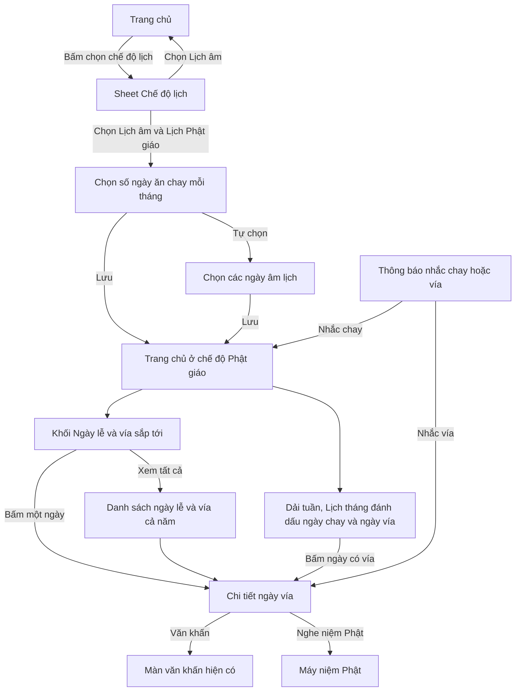
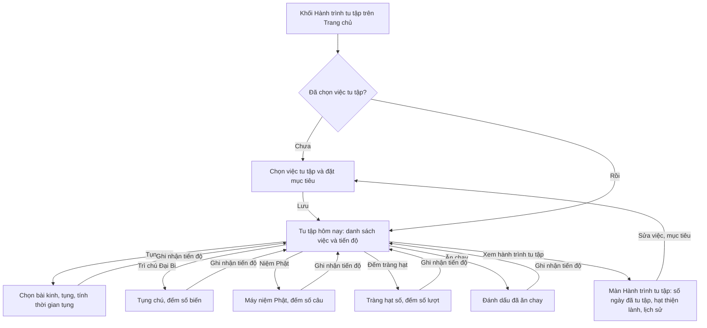

# BPRD: Lịch Phật giáo (Đại thừa) – Giai đoạn 1

> Business and Product Requirements Document

## 1. Thông tin tài liệu

| **Trường**  | **Nội dung**                                                                                           |
| ------------------- | ------------------------------------------------------------------------------------------------------------- |
| Tên dự án        | Lịch Phật giáo – Đại thừa (Bắc tông), giai đoạn 1                                                  |
| Người phụ trách | Đỗ Thị Hường                                                                                             |
| Phiên bản         | v1.0                                                                                                          |
| Trạng thái        | Bản nháp                                                                                                    |
| Nhóm tham gia      | Product, Design, Dev (App, Backend), QA, Nội dung Phật giáo, Cố vấn chuyên môn Phật giáo, Kinh doanh |
| Mức độ ưu tiên | Cao                                                                                                           |

## Nhật ký thay đổi

| Ngày cập nhật | Phiên bản | Người thực hiện | Nội dung thay đổi  |
| ---------------- | ----------- | ------------------- | --------------------- |
| 2026-11-07       | v1.0        | Đỗ Thị Hường   | Khởi tạo tài liệu |

---

## 2. Tổng quan kinh doanh (Business Context)

### 2.1. Vấn đề

**Phía người dùng**

- **Ngày chay khó nhớ.** Mỗi người ăn chay theo một cách (2, 4, 6 hay 10 ngày mỗi tháng). Lịch âm thông thường chỉ làm nổi mùng 1 và rằm, nên người ăn 6 hoặc 10 ngày phải tự đếm. Tháng thiếu (không có ngày 30) làm ngày chay cuối tháng bị lệch, dễ ăn sai ngày hoặc bỏ sót.
- **Ngày vía rải rác, dễ quên.** Một năm có khoảng 20 ngày vía và lễ lớn, có vị Bồ Tát có tới 3 ngày vía (Quán Thế Âm: 19/2, 19/6, 19/9). Người dùng thường chỉ biết khi chùa thông báo hoặc người nhà nhắc.
- **Biết ngày nhưng không biết làm gì.** Đến ngày vía, người dùng chưa rõ ý nghĩa, nên tụng kinh gì, khấn gì. Họ phải tìm trên mạng với nguồn không thống nhất.
- **Muốn nghe hơn muốn đọc.** Người lớn tuổi khó đọc chữ nhỏ, người bận rộn muốn mở niệm Phật khi làm việc, lái xe hay đi ngủ.
- **Khó giữ thời khóa tu tập hằng ngày.** Người dùng tự đặt cho mình việc tu tập (tụng kinh, trì chú, niệm Phật đủ số biến) nhưng phải dùng nhiều công cụ rời rạc (sách kinh, tràng hạt, app đếm) và không biết mình đã giữ được bao nhiêu ngày. Om Mani có công cụ này nhưng bị chê ghi nhận sai số liệu và không nhập tay được.

**Phía Lịch Việt**

- Người dùng có nhu cầu tâm linh vẫn xem lịch âm trên Lịch Việt, nhưng phải dùng thêm app khác cho phần Phật giáo. Lịch Việt mất các phiên dùng này.
- Om Mani đang tăng trưởng nhanh nhờ TikTok (số đánh giá mỗi tháng tăng từ 2 lên 127–191 kể từ 08/2026). Om Mani đã có lịch âm, ngày tốt xấu và sổ ngày giỗ. Nếu không có phản ứng, Lịch Việt có nguy cơ mất luôn nhu cầu xem lịch âm hằng ngày của nhóm người dùng này.

### 2.2. Thực tế thị trường

> Số liệu lấy ngày 07/11/2026. Lượt tải Android là ước tính của AppGoblin (bên thứ ba), không phải số liệu Google Play gốc.

**Quy mô nhu cầu**

- Theo Sách trắng Tôn giáo (03/2023), Việt Nam có **hơn 14 triệu tín đồ Phật giáo**, đông nhất trong các tôn giáo, và 18.544 cơ sở thờ tự ([VietnamPlus](https://www.vietnamplus.vn/tu-do-ton-giao-o-vietnam-nhung-con-so-khong-biet-doi-lua-post1099635.vnp)).
- Số người thực hành theo lệ dân gian (đi chùa, ăn chay mùng 1 và rằm) còn lớn hơn số tự nhận là tín đồ. Khảo sát năm 2019 cho thấy 55% người được hỏi có ăn chay, trong đó 28,5% ăn thường xuyên ([Tạp chí Công Thương](https://tapchicongthuong.vn/co-hoi-va-thach-thuc-doi-voi-thuc-pham-chay-83993.htm?print=print)).
- Nhu cầu nghe giảng, nghe kinh hiện nằm chủ yếu trên YouTube và TikTok. Kênh "Vấn đáp Thầy Thích Pháp Hòa" có 1,58 triệu người đăng ký ([vidIQ](https://vidiq.com/youtube-stats/channel/UCmryD9v9Qh_hkdZTEMjQ0Xw)). Thầy Giác Minh Luật có hơn 3,1 triệu người theo dõi TikTok ([VietNamNet](https://vietnamnet.vn/en/vietnamese-monk-captures-gen-z-audience-with-relatable-life-advice-on-tiktok-2329584.html)).

**Đối thủ và sản phẩm thay thế**

| Nhóm                      | Sản phẩm                                                                         | Quy mô                                                       | Lịch Phật giáo                                                                           | Audio                                 | Quảng cáo                    | Điểm yếu                                                  |
| -------------------------- | ---------------------------------------------------------------------------------- | ------------------------------------------------------------- | ------------------------------------------------------------------------------------------- | ------------------------------------- | ------------------------------ | ------------------------------------------------------------ |
| App Phật giáo tổng hợp | **Om Mani – Phật giáo** (iOS, Android)                                    | 4,9★ / ~17.000 lượt, #4 Top Miễn phí nhóm Tham khảo    | Có ngày vía, sổ ngày giỗ, nhắc Thập trai                                            | Có, mới từ 09/2026, còn hạn chế | Không                         | Lịch nông, từng sai ngày âm và tiết khí ([[Analysis-DoiThu-OmMani]])           |
| App lịch âm              | **Lịch Vạn Niên 2026** (Zegome, Android)                                  | 4,79★ / ~143.000 lượt, ~10,8 triệu lượt tải            | Chỉ có văn khấn, ngày tốt xấu. Không có ngày vía, chế độ chay                 | Không                                | Có, kèm mua trong app        | Không phục vụ riêng nhu cầu Phật giáo                 |
| App lịch âm              | **vLunar** (iOS)                                                             | 4,7★ / 6.400 lượt                                          | Nhắc mùng 1, 14, rằm, cuối tháng. Không có ngày vía, không chọn hình thức chay | Không                                | Gói Pro trả phí             | Chỉ nhắc cố định                                        |
| App Phật giáo nhỏ       | **Niệm Bình An** (iOS)                                                     | 4,6★ / 74 lượt                                             | Có đặt lịch ăn chay                                                                    | Nghe kinh                             | Không, có ủng hộ tùy tâm | Không cập nhật từ 02/2024, bị báo treo màn hình      |
| App Phật giáo nhỏ       | **Đi Chùa Online** (iOS)                                                   | 1★ / 1 lượt                                                | Mô tả có ngày vía, đại lễ, nhắc tu tập                                            | Tụng kinh, niệm Phật               | Không                         | Mới, chưa có người dùng                                |
| App nghe kinh              | **Máy niệm Phật – Nghe Kinh** (BiMi), **Diệu Pháp Âm** (ViMobi) | Vài trăm lượt tải; 4,5★ / 57 lượt                     | Không có lịch                                                                            | Có                                   | BiMi có quảng cáo           | Diệu Pháp Âm bị báo lỗi, không cập nhật từ 11/2024 |
| App chính thức           | **Phật Giáo** (phatgiao.org.vn, iOS)                                       | 4,0★ / 5 lượt                                              | Không có lịch, chỉ có tin tức                                                         | Không                                | Không                         | Không cập nhật từ 2022, bị báo không mở được      |
| App thiền                 | **Plum Village – Làng Mai** (iOS, Android)                                 | 4,9★ / 382 lượt (VN), hơn 1 triệu lượt tải toàn cầu | Không có lịch                                                                            | Thiền dẫn, bài tụng               | Không                         | Không phục vụ ngày chay, ngày vía                      |
| Kênh thay thế            | YouTube, TikTok, web tra ngày chay (ngaydep.com)                                  | Rất lớn                                                     | Web có bài "tháng X ăn chay ngày nào"                                                 | Có                                   | Có                            | Không có nhắc nhở, không cá nhân hóa                 |

**Nhận định**

- **Chưa sản phẩm nào cho chọn hình thức ăn chay (2, 4, 6, 10 ngày) kèm nhắc nhở.** App lịch âm lớn nhất không có tính năng chay. vLunar chỉ nhắc cố định. Niệm Bình An có lịch chay nhưng đã bỏ cập nhật.
- **Chưa có lịch ngày vía Đại thừa đáng tin.** Om Mani có nhưng nông và từng sai. Các app lịch âm chỉ có ngày tốt xấu, văn khấn.
- **App Phật giáo trong nước phần lớn ít người dùng và không được bảo trì.** Ngoài Om Mani, các app đều chỉ có vài chục lượt đánh giá và lâu không cập nhật.
- **Không quảng cáo là điểm khác biệt thật.** Chỉ Om Mani và Plum Village làm được, và đều được đánh giá 4,9★.
- **Nhu cầu chủ yếu đang được phục vụ gián tiếp qua app lịch âm và YouTube.** Thêm chế độ Phật giáo vào app lịch là đi đúng nơi người dùng đã có mặt. Một máy niệm Phật mở thẳng từ thông báo ngày chay, ngày vía nối được bước "biết hôm nay là ngày gì" với bước "nghe gì".

### 2.3. Cơ hội

- **Khoảng trống chế độ chay và lịch ngày vía chính xác** (mục 2.2): chưa đối thủ nào làm tốt cả hai.
- **Lịch là điểm yếu của đối thủ nhưng là lõi của Lịch Việt.** Om Mani từng sai ngày âm ở một số quốc gia và sai tiết khí. Lịch Việt đã có lõi lịch âm ổn định, có thể thắng bằng độ chính xác và độ đầy đủ của ngày chay, ngày vía.
- **Có sẵn tệp người dùng.** Người dùng Lịch Việt đã mở lịch hằng ngày. Chỉ cần bật chế độ, không phải thuyết phục họ tải app mới.
- **Dùng lại tài sản có sẵn.** Lõi lịch âm, văn khấn, hạ tầng thông báo, khối Trang chủ.
- **Nhu cầu lặp lại theo chu kỳ.** Ngày chay lặp hằng tháng, ngày vía lặp hằng năm. Mỗi lần nhắc là một lý do để mở app.

### 2.4. Mục tiêu và KPIs

**Mục tiêu sản phẩm**

- Người dùng không bỏ sót ngày chay, ngày vía theo đúng cách tu tập của mình.
- Đến ngày vía, người dùng biết ngay hôm nay nên làm gì và làm được ngay trong app.
- Người dùng giữ được thời khóa tu tập hằng ngày tự đặt, có đủ công cụ (tụng kinh, trì chú, niệm Phật, tràng hạt) trong một nơi và thấy được hành trình của mình.
- Trải nghiệm thanh tịnh: không có quảng cáo trong các màn hình Phật giáo.

**Mục tiêu kinh doanh**

- **Giữ chân:** tăng tần suất mở app của nhóm người dùng có nhu cầu Phật giáo nhờ nhắc ngày chay, ngày vía và thói quen tu tập hằng ngày.
- **Thu hút người dùng mới:** có thêm lượt cài từ nhóm từ khóa "lịch Phật giáo", "lịch ăn chay", "niệm Phật" và từ người dùng đang tìm app thay thế.
- **Doanh thu:**
  - Gián tiếp: nhiều phiên mở app hơn thì Trang chủ có nhiều lượt hiển thị quảng cáo hơn (Trang chủ vẫn giữ quảng cáo như hiện tại).
  - Trực tiếp: hình thức kiếm tiền trong luồng Phật giáo chưa chốt (xem câu hỏi mở Q6).

**KPIs cốt lõi** (mục tiêu là đề xuất, cần xác nhận)

| **Mã** | **Chỉ số**                                             | **Định nghĩa / Cách tính**                                                                                   | **Mục tiêu**                  | **Tần suất đo** |
| :------------ | :------------------------------------------------------------- | :---------------------------------------------------------------------------------------------------------------------- | :------------------------------------ | :----------------------- |
| **K01** | Tỷ lệ bật chế độ Phật giáo                             | Số người dùng đang ở chế độ "Lịch âm và Lịch Phật giáo" / MAU                                            | Đặt baseline tháng đầu           | Hàng tuần              |
| **K02** | Tỷ lệ giữ chân D30 của nhóm Phật giáo                  | Retention D30 của người dùng bật chế độ, so với nhóm cùng thời điểm không bật                           | Cao hơn nhóm không bật            | Hàng tháng             |
| **K03** | Số ngày mở app mỗi tháng                                  | Số ngày có phiên trung bình của nhóm bật chế độ, so với trước khi bật                                    | Tăng so với trước khi bật        | Hàng tháng             |
| **K07** | Tỷ lệ người dùng tu tập hằng ngày                      | Số người dùng có ít nhất 1 việc tu tập hoàn thành trong ngày / Số người dùng bật chế độ Phật giáo | Đặt baseline tháng đầu           | Hàng tuần              |
| **K04** | Tỷ lệ mở thông báo nhắc                                  | Số lượt mở thông báo nhắc chay hoặc vía / Số thông báo đã gửi                                            | Đặt baseline tháng đầu           | Hàng tuần              |
| **K05** | Lượt cài mới từ nhóm từ khóa Phật giáo               | Lượt cài từ tìm kiếm App Store và Google Play với nhóm từ khóa Phật giáo                                   | Đặt baseline sau khi cập nhật ASO | Hàng tháng             |
| **K06** | Lượt hiển thị quảng cáo Trang chủ từ nhóm Phật giáo | Lượt hiển thị quảng cáo ở Trang chủ của người dùng bật chế độ                                           | Không giảm so với trước khi bật | Hàng tháng             |

### 2.4.1. Chỉ số gắn kết

| **Mã** | **Chỉ số**                         | **Định nghĩa**                                                                                                                        | **Mục tiêu**                       |
| :------------ | :----------------------------------------- | :--------------------------------------------------------------------------------------------------------------------------------------------- | :----------------------------------------- |
| **E01** | Phân bổ hình thức chay                 | Tỷ lệ người dùng chọn 2, 4, 6, 10 ngày hoặc tự chọn                                                                                  | Theo dõi, làm căn cứ cho giai đoạn 2 |
| **E02** | Tỷ lệ xem chi tiết ngày vía           | Số lượt xem chi tiết ngày vía / Số người dùng bật chế độ, trong tuần có ngày vía                                             | Đặt baseline                             |
| **E03** | Tỷ lệ đi tiếp từ chi tiết ngày vía | Tỷ lệ bấm sang văn khấn, nghe niệm Phật từ chi tiết ngày vía                                                                        | Đặt baseline                             |
| **E04** | Thời lượng niệm Phật                  | Thời lượng nghe bình quân mỗi phiên và mỗi người dùng mỗi tuần                                                                   | Đặt baseline                             |
| **E06** | Phân bổ việc tu tập                    | Tỷ lệ người dùng chọn từng việc (tụng kinh, trì chú, niệm Phật, tràng hạt, ăn chay) và mục tiêu bình quân của mỗi việc | Theo dõi                                  |
| **E07** | Tỷ lệ hoàn thành việc tu tập         | Số việc đạt mục tiêu / Số việc đã đặt, tính theo ngày                                                                            | Đặt baseline                             |
| **E08** | Chuỗi ngày tu tập                       | Số ngày tu tập liên tiếp bình quân của người dùng đã đặt việc tu tập                                                          | Đặt baseline                             |
| **E05** | Tỷ lệ tắt nhắc                         | Tỷ lệ người dùng tắt nhắc chay hoặc vía sau khi đã nhận thông báo                                                                | Theo dõi, cảnh báo nếu tăng           |

> **Ghi chú phân tích:** Tách các chỉ số theo nền tảng (iOS, Android), nhóm tuổi và hình thức chay.

### 2.5. Phạm vi (Scope)

**Nằm trong phạm vi**

- Chế độ lịch "Lịch âm và Lịch Phật giáo", chọn và đổi tại sheet Chế độ lịch.
- Hình thức ăn chay: 2, 4, 6, 10 ngày mỗi tháng hoặc tự chọn ngày.
- Đánh dấu ngày chay, ngày vía trên Trang chủ (dải tuần, khối Hôm nay) và Lịch tháng.
- Khối "Ngày lễ & vía Phật giáo sắp tới" trên Trang chủ và màn danh sách ngày lễ, vía cả năm.
- Màn chi tiết ngày vía, lễ lớn: ý nghĩa, việc nên làm, kinh nên tụng (gợi ý tên), nút sang văn khấn và nghe niệm Phật.
- Câu kinh trong ngày trên khối Hôm nay.
- Thông báo nhắc ngày chay, ngày vía, có cài đặt riêng.
- Máy niệm Phật dạng audio ở mức tối thiểu.
- Tu tập:
  - người dùng tự chọn việc tu tập hằng ngày và đặt mục tiêu cho từng việc;
  - khối "Hành trình tu tập của bạn" trên Trang chủ, gồm "Tu tập hôm nay" và thống kê tháng;
  - màn Hành trình tu tập;
  - 5 việc: tụng kinh, trì chú Đại Bi, niệm Phật, đếm tràng hạt, ăn chay.
- Tụng kinh: danh sách bài kinh, chú (gồm Chú Đại Bi), màn tụng kinh có tự cuộn, gõ mõ kèm theo và audio tụng kinh có chữ chạy theo.
- Không hiển thị quảng cáo trong các màn hình Phật giáo.

**Nằm ngoài phạm vi (giai đoạn 1)**

- Kho kinh đa truyền thống, đa ngôn ngữ (Om Mani có hơn 100 bài, 27 ngôn ngữ). Giai đoạn 1 chỉ làm danh sách bài do cố vấn chọn (Q10).
- Chay Quan Âm, chay cả tháng (tháng Giêng, tháng 7), chay trường, Bát quan trai.
- Tính ngày cúng thất tuần, 49 ngày, 100 ngày, giỗ đầu, giỗ hết.
- Chuông, mõ dùng riêng ngoài màn tụng kinh, thiền định, đồng bộ Apple Health hoặc Google Fit.
- Thẻ chia sẻ hành trình tu tập lên mạng xã hội.
- Nội dung do người dùng viết (phòng cầu nguyện, hồi hướng cộng đồng).
- Lịch Phật giáo Nam tông và Kim Cương thừa.
- Widget màn hình chính, màn hình khóa.

---

## 3. Người dùng mục tiêu (User Personas & JTBD)

### 3.1. Chân dung người dùng

- **Persona 1: Cô Hạnh (56 tuổi, Phật tử thuần thành)**
  - *Đặc điểm*: Quy y, ăn chay 10 ngày mỗi tháng, đi chùa vào ngày rằm và ngày vía. Mắt kém, ngại đọc chữ nhỏ.
  - *Hành vi*: Xem lịch treo tường hoặc hỏi chùa để biết ngày chay. Hay mở niệm Phật trên YouTube khi làm việc nhà.
- **Persona 2: Chị Mai (34 tuổi, nhân viên văn phòng)**
  - *Đặc điểm*: Ăn chay mùng 1 và rằm theo gia đình, cúng vào ngày vía Quán Thế Âm. Bận rộn, hay quên.
  - *Hành vi*: Mở Lịch Việt để xem ngày âm và ngày tốt. Cần được nhắc từ tối hôm trước để chuẩn bị đồ chay, đồ cúng.
- **Persona 3: Anh Tuấn (27 tuổi, mới tìm hiểu Phật pháp)**
  - *Đặc điểm*: Biết tới Phật giáo qua TikTok, chưa rõ các ngày lễ.
  - *Hành vi*: Muốn hiểu ý nghĩa ngày lễ, nghe niệm Phật để tâm an, dễ ngủ.

### 3.2. Jobs-to-be-Done

- **JTBD 1**: Khi tôi ăn chay theo một số ngày cố định mỗi tháng, tôi muốn được nhắc đúng ngày chay của mình từ tối hôm trước, để chuẩn bị đồ ăn và không ăn sai ngày.
- **JTBD 2**: Khi sắp tới một ngày vía, tôi muốn biết trước và biết hôm đó nên làm gì, để đi chùa, cúng hoặc tụng kinh cho đúng.
- **JTBD 3**: Khi làm việc nhà, lái xe hay trước khi ngủ, tôi muốn nghe niệm Phật mà không cần nhìn màn hình, để giữ tâm an.
- **JTBD 4**: Khi đã phát nguyện mỗi ngày tụng kinh, trì chú hay niệm Phật đủ số biến, tôi muốn làm và đếm ngay trong một app, xem được mình đã giữ bao nhiêu ngày, để duy trì thời khóa tu tập.

---

## 4. Yêu cầu nghiệp vụ (Business Requirements)

### 4.1. Luồng nghiệp vụ

**Luồng tu tập**

### 4.2. Quy tắc kinh doanh (Business Rules)

- **BR-1 (Chế độ lịch)**:

  - Có 2 chế độ: "Lịch âm" và "Lịch âm và Lịch Phật giáo". Người dùng chọn và đổi tại sheet Chế độ lịch.
  - Chế độ Phật giáo dùng chung màn Trang chủ, chỉ thay và sắp xếp lại nội dung.
  - Chế độ mặc định khi cài app đang chờ xác nhận (Q3).
- **BR-2 (Nguồn ngày vía, lễ lớn)**:

  - Danh mục lấy theo lịch của Giáo hội Phật giáo Việt Nam. Danh mục đề xuất ở Phụ lục A, cần cố vấn chuyên môn duyệt trước khi phát hành.
  - Danh mục và nội dung chi tiết do server trả về, cập nhật được mà không cần phát hành bản app mới.
- **BR-3 (Phật đản, Phật lịch)**:

  - Phật đản hiển thị ngày 15/4 âm lịch, theo Giáo hội Phật giáo Việt Nam.
  - Năm Phật lịch đổi vào ngày Phật đản. Ví dụ: từ Phật đản năm 2026 là Phật lịch 2570.
- **BR-4 (Ngày chay theo hình thức)**:

  | Hình thức | Ngày âm lịch (tháng đủ)                 | Tháng thiếu (đề xuất) |
  | ----------- | --------------------------------------------- | -------------------------- |
  | 2 ngày     | 1, 15                                         | Không đổi               |
  | 4 ngày     | 1, 14, 15, 30                                 | 30 → 29                   |
  | 6 ngày     | 8, 14, 15, 23, 29, 30                         | 29, 30 → 28, 29           |
  | 10 ngày    | 1, 8, 14, 15, 18, 23, 24, 28, 29, 30          | 28, 29, 30 → 27, 28, 29   |
  | Tự chọn   | Người dùng chọn các ngày từ 1 đến 30 | Ngày 30 → 29             |

  > Mỗi hình thức có vài cách tính khác nhau giữa các vùng và các chùa. Bảng trên là đề xuất, cần cố vấn duyệt (Q2).
  >
- **BR-5 (Tháng nhuận)**:

  - Ngày chay áp dụng cả tháng nhuận.
  - Ngày vía, lễ lớn chỉ tính ở tháng chính, không lặp lại ở tháng nhuận.
- **BR-6 (Ngày âm theo giờ Việt Nam)**: Ngày âm lịch, ngày chay, ngày vía tính theo múi giờ Việt Nam (UTC+7), không phụ thuộc múi giờ của máy. Om Mani từng sai ngày âm vì lỗi này.
- **BR-7 (Thông báo nhắc)**:

  - Nhắc ngày chay và nhắc ngày vía bật, tắt riêng.
  - Giờ nhắc mặc định: 20:00 tối hôm trước. Người dùng đổi được giờ nhắc.
  - Ngày chay trùng ngày vía thì gộp thành một thông báo.
  - Nhắc chỉ hoạt động khi đang ở chế độ Phật giáo.
- **BR-8 (Không quảng cáo)**:

  - Các màn Phật giáo không hiển thị quảng cáo: danh sách ngày lễ và vía, chi tiết ngày vía, máy niệm Phật, cài đặt nhắc, chọn việc tu tập, Hành trình tu tập, tụng kinh, tràng hạt.
  - Trang chủ, kể cả khi ở chế độ Phật giáo, vẫn hiển thị quảng cáo như hiện tại.
- **BR-9 (Hình ảnh và nội dung trang nghiêm)**: Hình ảnh Phật, Bồ Tát và toàn bộ nội dung Phật giáo phải được cố vấn chuyên môn duyệt trước khi phát hành.
- **BR-10 (Lưu cài đặt)**: Chế độ lịch, hình thức chay, cài đặt nhắc và dữ liệu tu tập lưu trên máy. Nếu đã đăng nhập thì đồng bộ lên tài khoản (đề xuất, chờ Q5).
- **BR-11 (Chọn việc tu tập)**:

  - Người dùng tự chọn một hoặc nhiều việc trong 5 việc và đặt mục tiêu hằng ngày cho từng việc. Sửa được bất cứ lúc nào, áp dụng từ ngày sửa.
  - Đơn vị mục tiêu theo bảng dưới.

  | Việc              | Đơn vị mục tiêu | Cách ghi nhận                                                                 | Ví dụ    |
  | ------------------ | -------------------- | ------------------------------------------------------------------------------- | ---------- |
  | Tụng kinh        | Phút                | Thời gian ở màn tụng kinh (tụng, đọc hoặc nghe audio), cộng dồn trong ngày  | 15 phút   |
  | Trì chú Đại Bi | Biến                | Đếm 1 biến mỗi lần đọc hết bài chú hoặc bấm "Xong 1 biến"          | 7 biến    |
  | Niệm Phật        | Câu                 | Đếm theo số câu máy niệm Phật đã phát, hoặc người dùng bấm đếm | 1.000 câu |
  | Đếm tràng hạt  | Lượt               | Bấm đếm từng hạt                                                           | 108 lượt |
  | Ăn chay           | Có / không         | Người dùng đánh dấu "Đã ăn chay"                                       | —         |
- **BR-12 (Nhập tay)**: Người dùng được nhập tay hoặc sửa số đã làm trong ngày cho mọi việc, để ghi nhận cả phần tu tập ngoài app (tụng ở chùa, dùng tràng hạt thật). Om Mani bị chê vì không cho nhập tay.
- **BR-13 (Ăn chay trong tu tập)**: Nếu người dùng chọn việc "Ăn chay", việc này chỉ xuất hiện trong Tu tập hôm nay vào các ngày chay theo hình thức đã chọn (BR-4).
- **BR-14 (Hoàn thành và hành trình)**:

  - Một việc hoàn thành khi đạt mục tiêu trong ngày.
  - Một ngày được tính "đã tu tập" khi có ít nhất 1 việc hoàn thành.
  - Hành trình tu tập thống kê số ngày đã tu tập trong tháng dương lịch và tổng số hạt thiện lành. Cách tính hạt thiện lành chờ xác nhận (Q9).
  - Ngày được tính theo giờ Việt Nam, như BR-6.
- **BR-15 (Nội dung kinh, chú)**:

  - Danh sách bài kinh, chú giai đoạn 1 do cố vấn chọn và duyệt (Q10). Nội dung tải từ server, đọc được không cần mạng sau lần tải đầu.
  - Audio tụng kinh phải có bản quyền rõ ràng, giọng tụng và chữ được cố vấn duyệt khớp nhau. Bài chưa có audio vẫn hiển thị dạng chữ.
  - Ưu tiên audio cho các bài phổ biến (A Di Đà, Phổ Môn, Dược Sư, Địa Tạng, Chú Đại Bi), vì nghe kinh là yêu cầu nhiều nhất trong đánh giá Om Mani.

---

## 5. Đặc tả tính năng cốt lõi

| **Mã** | **Tính năng**                      | **Mô tả**                                                                                                                                                                                                                                                                                                                                                                                                             | **User Story** | **Giai đoạn** | **Trạng thái** |
| :------------ | :----------------------------------------- | :---------------------------------------------------------------------------------------------------------------------------------------------------------------------------------------------------------------------------------------------------------------------------------------------------------------------------------------------------------------------------------------------------------------------------- | :------------------- | :-------------------- | :--------------------- |
| **F01** | Chọn chế độ lịch và hình thức chay | Sheet Chế độ lịch: chọn "Lịch âm" hoặc "Lịch âm và Lịch Phật giáo". Khi chọn chế độ Phật giáo thì chọn số ngày ăn chay (2, 4, 6, 10 hoặc tự chọn).                                                                                                                                                                                                                                                | Chưa tạo           | GĐ1                  | Đang phân tích      |
| **F02** | Đánh dấu ngày chay, ngày vía         | Dấu chay và vía trên dải tuần Trang chủ và Lịch tháng. Khối Hôm nay hiển thị tên ngày vía, lễ lớn (nếu có) và câu kinh trong ngày.                                                                                                                                                                                                                                                                    | Chưa tạo           | GĐ1                  | Đang phân tích      |
| **F03** | Ngày lễ và vía sắp tới               | Khối trên Trang chủ hiển thị 3 ngày lễ, vía gần nhất kèm ngày âm, ngày dương và số ngày còn lại. "Xem tất cả" mở danh sách cả năm.                                                                                                                                                                                                                                                                 | Chưa tạo           | GĐ1                  | Đang phân tích      |
| **F04** | Chi tiết ngày vía, lễ lớn             | 4 phần: (1) Thông tin ngày: tên, ngày âm kèm năm can chi (dạng "17 Tháng 11, Bính Ngọ", giống Trang chủ), ngày dương kèm nhãn "Còn N ngày" hoặc "Hôm nay". Nhắc ngày vía bật ở cài đặt nhắc (F05), không có nút trên màn này. (2) Khối danh hiệu niệm Phật, rồi ý nghĩa 2–3 câu. (3) "Những việc nên làm trong ngày vía": các ô việc gợi ý xếp lưới 2 cột (biểu tượng, tên việc; không có mô tả). Bấm vào ô để mở tính năng tương ứng: Tụng kinh (đúng bài), Máy niệm Phật (đúng câu niệm), Tu tập (thêm việc ăn chay), Văn khấn. "Làm việc thiện" chưa có tính năng để mở (chờ chốt). (4) Khám phá thêm: bài kinh liên quan, ngày lễ và vía tiếp theo. Không hiển thị thông tin ngày tốt xấu.                                                                                                                                                                                                                                                                                | Chưa tạo           | GĐ1                  | Đang phân tích      |
| **F05** | Nhắc ngày chay, ngày vía               | Thông báo đẩy theo BR-7. Màn cài đặt nhắc: bật, tắt từng loại và chọn giờ nhắc.                                                                                                                                                                                                                                                                                                                              | Chưa tạo           | GĐ1                  | Đang phân tích      |
| **F06** | Máy niệm Phật                           | Chọn câu niệm (Nam Mô A Di Đà Phật, Nam Mô Quán Thế Âm Bồ Tát, Om Mani Padme Hum), phát lặp liên tục, phát nền khi tắt màn hình, điều khiển ở màn hình khóa, hẹn giờ tắt. Đếm số câu đã niệm để ghi nhận vào tu tập.                                                                                                                                                              | Chưa tạo           | GĐ1                  | Đang phân tích      |
| **F07** | Chọn việc tu tập và mục tiêu         | Chọn việc trong 5 việc, đặt mục tiêu hằng ngày theo BR-11.                                                                                                                                                                                                                                                                                                                                                           | Chưa tạo           | GĐ1                  | Đang phân tích      |
| **F08** | Tu tập hôm nay                           | Trên Trang chủ: danh sách việc chưa xong kèm tiến độ và nút "Bắt đầu" hoặc "Tiếp tục", nhóm việc đã xong, số việc còn lại. Nhập tay số đã làm theo BR-12.                                                                                                                                                                                                                                       | Chưa tạo           | GĐ1                  | Đang phân tích      |
| **F09** | Hành trình tu tập                       | Thống kê tháng (số ngày đã tu tập, hạt thiện lành) trên Trang chủ. Màn Hành trình tu tập hiển thị lịch sử theo ngày.                                                                                                                                                                                                                                                                                    | Chưa tạo           | GĐ1                  | Đang phân tích      |
| **F10** | Tụng kinh                               | Danh sách bài kinh, chú theo nhóm. Mục "Tụng Kinh" trên Trang chủ. Màn tụng kinh: đổi cỡ chữ, giữ màn hình sáng, nhớ vị trí đọc, tự cuộn có chỉnh tốc độ, gõ mõ kèm theo (gõ tay hoặc tự động theo nhịp). Bài có audio thì nghe tụng kèm chữ chạy theo, phát nền và điều khiển ở màn hình khóa, tải về để nghe không cần mạng. Đếm thời gian tụng hoặc số biến để ghi nhận vào tu tập. | Chưa tạo           | GĐ1                  | Đang phân tích      |
| **F11** | Tràng hạt số                            | Bấm đếm từng hạt, rung nhẹ mỗi hạt, báo khi đủ một vòng 108 hạt và khi đạt mục tiêu.                                                                                                                                                                                                                                                                                                                       | Chưa tạo           | GĐ1                  | Đang phân tích      |

---

## 6. Thiết kế

| Màn hình                                  | Thiết kế                                                                               | Tính năng |
| ------------------------------------------- | ---------------------------------------------------------------------------------------- | ----------- |
| Trang chủ ở chế độ Phật giáo         | Prototype `prototype/TrangChu_2026.html`, trạng thái 1 và 2 (cập nhật link Figma) | F02, F03    |
| Sheet Chế độ lịch                       | Prototype `prototype/TrangChu_2026.html`, trạng thái 3                               | F01         |
| Danh sách ngày lễ và vía cả năm      | Chưa có                                                                                | F03         |
| Chi tiết ngày vía                        | Prototype `prototype/ChiTietNgayVia.html` (Vía Phật A Di Đà): sắp tới, hôm nay | F04         |
| Cài đặt nhắc                            | Chưa có                                                                                | F05         |
| Máy niệm Phật                            | Chưa có                                                                                | F06         |
| Khối Hành trình tu tập trên Trang chủ | Prototype `prototype/TrangChu_2026.html`, trạng thái 2                               | F08, F09    |
| Chọn việc tu tập và mục tiêu          | Chưa có                                                                                | F07         |
| Màn Hành trình tu tập                   | Chưa có                                                                                | F09         |
| Danh sách kinh, chú và màn tụng kinh   | Chưa có                                                                                | F10         |
| Tràng hạt số                             | Chưa có                                                                                | F11         |

---

## 7. Yêu cầu phi chức năng

- **Độ chính xác**: Ngày chay, ngày vía từ năm 2026 đến 2030 khớp 100% với bảng đối chiếu đã được cố vấn duyệt, gồm các năm có tháng nhuận và tháng thiếu.
- **Hoạt động không cần mạng**: Ngày chay, ngày vía tính trên máy từ lõi lịch âm. Thông báo nhắc vẫn gửi đúng khi máy không có mạng.
- **Audio**: Phát nền ổn định khi tắt màn hình hoặc chuyển app. Các câu niệm tải một lần rồi phát được không cần mạng. Âm thanh thu chuẩn, có bản quyền sử dụng rõ ràng.
- **Hiển thị cho người lớn tuổi**: Chữ trên màn chi tiết ngày vía và máy niệm Phật đọc rõ khi người dùng tăng cỡ chữ hệ thống.
- **Vận hành nội dung**: Danh mục ngày vía, nội dung chi tiết, câu kinh trong ngày cập nhật từ server.
- **Log & Tracking**: Gắn sự kiện cho các chỉ số ở mục 2.4: đổi chế độ lịch (kèm hình thức chay), nhận và mở thông báo nhắc (kèm loại), xem chi tiết ngày vía (kèm mã ngày), bấm văn khấn, bấm nghe niệm Phật, phát và dừng niệm Phật (kèm câu niệm, thời lượng).
- **Tương thích**: Theo cấu hình hệ điều hành tối thiểu hiện tại của Lịch Việt (iOS, Android).

---

## 8. Trường hợp ngoại lệ (Edge Cases)

- **Tháng thiếu**: Ngày chay đổi theo BR-4. Ngày vía rơi vào ngày 30 (Vía Địa Tạng 30/7, Vía Phật Dược Sư 30/9) chuyển sang ngày 29.
- **Tháng nhuận**: Theo BR-5.
- **Máy ở nước ngoài, khác múi giờ**: Ngày âm tính theo giờ Việt Nam (BR-6).
- **Người dùng chưa cấp quyền thông báo**: Khi bật nhắc, app xin quyền. Bị từ chối thì màn cài đặt nhắc hiển thị hướng dẫn mở quyền trong cài đặt máy.
- **Ngày chay trùng ngày vía**: Một thông báo gộp (BR-7). Lịch hiển thị cả hai dấu.
- **Đổi về chế độ Lịch âm**: Ngừng nhắc chay, nhắc vía. Giữ lại hình thức chay đã chọn để dùng khi bật lại.
- **Chưa tải audio và mất mạng**: Máy niệm Phật báo cần kết nối mạng để tải lần đầu.
- **Đang phát niệm Phật thì có cuộc gọi**: Tạm dừng, phát tiếp sau khi kết thúc cuộc gọi.
- **Đang tu tập qua nửa đêm**: Phần làm trước 00:00 tính cho ngày cũ, phần sau tính cho ngày mới.
- **Vượt mục tiêu**: Vẫn ghi nhận số thực tế, việc giữ trạng thái hoàn thành.
- **Sửa mục tiêu giữa ngày**: Áp dụng ngay cho ngày hiện tại. Không tính lại các ngày trước.
- **Bỏ chọn một việc**: Việc biến mất khỏi Tu tập hôm nay, lịch sử của việc đó vẫn giữ trong Hành trình tu tập.
- **Tắt chế độ Phật giáo**: Ẩn khối Hành trình tu tập trên Trang chủ, giữ dữ liệu tu tập để dùng khi bật lại.

---

## 9. Câu hỏi mở

| Mã | Câu hỏi                                                                                                                                                                           | Liên quan                       | Người trả lời   |
| --- | ----------------------------------------------------------------------------------------------------------------------------------------------------------------------------------- | -------------------------------- | ------------------- |
| Q1  | Ai là cố vấn chuyên môn duyệt danh mục ngày vía, cách tính ngày chay, nội dung chi tiết và hình ảnh?                                                               | BR-2, BR-4, BR-9; Elicitation C2 | Product             |
| Q2  | Chốt cách tính ngày chay cho từng hình thức và cho tháng thiếu. Có cho người dùng tự chỉnh không?                                                                  | BR-4; Elicitation D1, D2         | Cố vấn            |
| Q3  | Chế độ mặc định khi cài app là gì? Có gợi ý bật chế độ Phật giáo cho người dùng hiện tại không, gợi ý ở đâu?                                           | BR-1; Elicitation F1, F2         | Product             |
| Q4  | Văn khấn hiện có đủ cho các ngày vía trong Phụ lục A chưa? Thiếu thì ai bổ sung?                                                                                     | F04; Elicitation G2              | Nội dung           |
| Q5  | Cài đặt chay, nhắc lưu trên máy hay đồng bộ tài khoản?                                                                                                                  | BR-10; Elicitation G1            | Dev                 |
| Q6  | Hình thức kiếm tiền trực tiếp trong luồng Phật giáo: không có, ủng hộ tùy hỉ, hay gói Premium? Có bán sản phẩm (tượng, tràng hạt) trong luồng này không? | 2.4; Elicitation H1, H2          | Kinh doanh          |
| Q7  | Nguồn audio niệm Phật: tự thu âm hay mua bản quyền? Giọng ai?                                                                                                               | F06                              | Product, Nội dung  |
| Q8  | Mốc ra mắt có cần kịp dịp lễ nào không (Rằm tháng Giêng, Phật đản)?                                                                                                  | Mục 10; Elicitation B1          | Product             |
| Q9  | Hạt thiện lành tính thế nào (mỗi việc hoàn thành được bao nhiêu hạt, có cộng theo số biến không)? Hạt dùng để làm gì ngoài hiển thị?                   | BR-14, F09                       | Product             |
| Q10 | Danh sách bài kinh, chú giai đoạn 1 gồm những bài nào, bao nhiêu bài có audio? Dùng bản dịch nào, giọng tụng của ai?                                             | BR-15, F10                       | Cố vấn, Nội dung |
| Q11 | Có nhắc tu tập hằng ngày (ví dụ 20:00 nếu chưa xong việc) không? Nếu có, gộp chung với nhắc chay, vía thế nào?                                                   | BR-7, F08                        | Product             |

---

## 10. Kế hoạch ra mắt

- **Giai đoạn 1 (Kiểm thử nội bộ)**: Đối chiếu ngày chay, ngày vía 2026–2030 với bảng đã duyệt. Kiểm tra thông báo nhắc trên các năm có tháng nhuận, tháng thiếu và khi máy đặt múi giờ nước ngoài.
- **Giai đoạn 2 (Phát hành)**: Phát hành cho toàn bộ người dùng trước một ngày vía hoặc lễ lớn khoảng 2 tuần, để người dùng nhận ngay lượt nhắc đầu tiên. Cập nhật mô tả và từ khóa trên App Store, Google Play với nhóm từ khóa Phật giáo.
- **Theo dõi**: KPIs mục 2.4 trong 4 tuần đầu. Kết quả E01, E04, E06 làm căn cứ chọn phạm vi giai đoạn 2 (mở rộng kho kinh và audio, chay Quan Âm).

---

## 11. Definition of Done

- [ ] Cố vấn chuyên môn đã duyệt danh mục ngày vía, cách tính ngày chay, nội dung chi tiết, bài kinh, chú và hình ảnh.
- [ ] Thiết kế các màn ở mục 6 đã được duyệt.
- [ ] Ngày chay, ngày vía 2026–2030 khớp bảng đối chiếu.
- [ ] Toàn bộ Acceptance Criteria trong các user story của F01–F11 đã pass.
- [ ] Các màn Phật giáo không còn vị trí quảng cáo.
- [ ] Đã gắn tracking và kiểm tra dữ liệu trên công cụ analytics.

---

## Phụ lục A. Danh mục ngày vía, lễ lớn (đề xuất, cần cố vấn duyệt)

| Ngày âm lịch | Tên ngày                                               |
| --------------- | -------------------------------------------------------- |
| 1/1             | Vía Phật Di Lặc                                       |
| 15/1            | Rằm tháng Giêng (Tết Thượng nguyên)               |
| 8/2             | Phật Thích Ca xuất gia                                |
| 15/2            | Phật Thích Ca nhập Niết bàn                         |
| 19/2            | Vía Bồ Tát Quán Thế Âm đản sinh                  |
| 21/2            | Vía Bồ Tát Phổ Hiền                                 |
| 4/4             | Vía Bồ Tát Văn Thù                                  |
| 15/4            | Lễ Phật đản                                          |
| 16/4            | Bắt đầu mùa An cư kiết hạ                         |
| 19/6            | Vía Bồ Tát Quán Thế Âm thành đạo                |
| 13/7            | Vía Bồ Tát Đại Thế Chí                            |
| 15/7            | Lễ Vu Lan báo hiếu, ngày Tự tứ (kết thúc An cư) |
| 30/7            | Vía Bồ Tát Địa Tạng                                |
| 19/9            | Vía Bồ Tát Quán Thế Âm xuất gia                   |
| 30/9            | Vía Phật Dược Sư                                    |
| 5/10            | Vía Tổ Bồ Đề Đạt Ma                               |
| 15/10           | Rằm tháng Mười (Tết Hạ nguyên)                    |
| 1/11            | Giỗ Phật hoàng Trần Nhân Tông (Tổ Trúc Lâm)     |
| 17/11           | Vía Phật A Di Đà                                     |
| 8/12            | Phật Thích Ca thành đạo                             |
