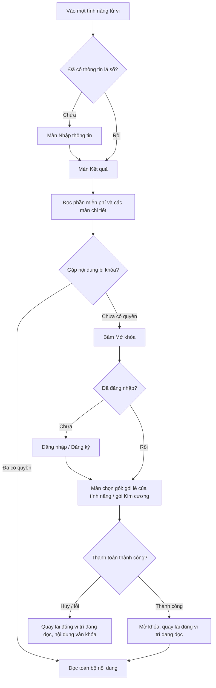

# BPRD: Nâng cấp tính năng Tử vi

> Business and Product Requirements Document

Tài liệu dùng chung cho toàn bộ đợt nâng cấp nhóm tính năng Tử vi. Các mục 2 → 4 áp dụng cho mọi giai đoạn. Mỗi giai đoạn có một mục riêng mô tả tính năng được nâng cấp: **Giai đoạn 1 là Tử vi vận hạn** (mục 5), các giai đoạn sau bổ sung dần (mục 6).

## 1. Thông tin tài liệu

| **Trường**      | **Nội dung**                                                                                 |
| --------------- | -------------------------------------------------------------------------------------------- |
| Tên dự án       | Nâng cấp tính năng Tử vi                                                                     |
| Giai đoạn hiện tại | Giai đoạn 1: Tử vi vận hạn (version 4.0)                                                  |
| Người phụ trách | Đỗ Thị Hường                                                                                 |
| Phiên bản       | v1.0                                                                                         |
| Trạng thái      | Bản nháp                                                                                     |
| Nhóm tham gia   | Product, Design, Dev (App, Backend), QA, Nội dung tử vi (chuyên gia luận giải), Kinh doanh   |
| Mức độ ưu tiên  | Cao                                                                                          |

## Nhật ký thay đổi

| Ngày cập nhật | Phiên bản | Người thực hiện | Nội dung thay đổi                                                     |
| ------------- | --------- | --------------- | --------------------------------------------------------------------- |
| 2026-11-19    | v1.0      | Đỗ Thị Hường    | Khởi tạo tài liệu: phần chung nhóm Tử vi và Giai đoạn 1 Tử vi vận hạn |

---

## 2. Tổng quan kinh doanh

### 2.1. Vấn đề và cơ hội

**Nhóm tính năng Tử vi hiện có**: Tử vi hôm nay, Tử vi tổng quan, Tử vi vận hạn, Tài chính & Đầu tư, Nghề nghiệp & Sự nghiệp, Tư vấn tình duyên, Lá số tử vi.

**Vấn đề**

- **Nội dung chung chung.** Luận giải ngắn và chưa tính đến hoàn cảnh riêng của người xem (công việc, hôn nhân, con cái). Người cùng tuổi nhận nội dung gần giống nhau, nên người dùng thấy luận giải "không đúng mình" và ít tin.
- **Thiếu chiều sâu tử vi.** Nội dung chỉ đưa kết luận tốt hay xấu mà không nói vì sao (sao nào, cung nào, đại vận nào) và cũng thiếu lời khuyên cụ thể nên làm gì, tránh gì. Mỗi tính năng lại chấm điểm theo một kiểu riêng (phần trăm, sao, nhãn chữ), khiến người dùng khó đọc.

> Hai vấn đề trên đã thấy rõ ở bản Tử vi vận hạn cũ (mục 5.1). Khi bắt đầu mỗi giai đoạn sau, cần rà lại tính năng đó và ghi vấn đề cụ thể vào mục của giai đoạn đó.

**Cơ hội**

- Tử vi là nhóm nội dung người dùng Lịch Việt quan tâm nhiều, tăng mạnh vào dịp cuối năm âm lịch.
- Khi luận giải đủ sâu và cá nhân hóa, người dùng có lý do để trả tiền. Đợt nâng cấp chuyển cả nhóm Tử vi sang mô hình **freemium**: xem miễn phí một phần, phần còn lại được làm mờ và mở khóa bằng **gói lẻ** (theo từng tính năng) hoặc **gói Kim cương** (mở toàn bộ).
- Bộ khung dùng chung (thang đánh giá, cấu trúc luận giải, dữ liệu hoàn cảnh, cơ chế mở khóa) chỉ làm một lần ở Giai đoạn 1, các giai đoạn sau dùng lại nên làm nhanh hơn.

### 2.2. Mục tiêu

**Mục tiêu kinh doanh**

- Tạo doanh thu từ việc mở khóa nội dung tử vi (gói lẻ theo tính năng) và tăng số gói Kim cương bán ra.
- Tăng độ tin cậy của mảng Tử vi để giữ chân người dùng.

**Mục tiêu sản phẩm**

- Luận giải sâu hơn: mỗi kết luận đều kèm nguồn gốc (sao, cung, đại vận) và lời khuyên hành động.
- Cá nhân hóa theo lá số đầy đủ (ngày giờ sinh, giới tính) và hoàn cảnh hiện tại.
- Thống nhất cách đánh giá, cách trình bày và cách mở khóa giữa các tính năng tử vi.

### 2.3. KPI

Bộ KPI dùng chung cho cả nhóm Tử vi. Mỗi chỉ số được đo riêng cho từng tính năng (tham số `feature`, ví dụ `tuvi_vanhan`) và cộng dồn cho cả nhóm.

> Chưa có số liệu nền của bản cũ. Mục tiêu dưới đây là **đề xuất**; chỉ số ghi "Đặt baseline" sẽ chốt mục tiêu sau 4 tuần chạy chính thức của từng giai đoạn.

**KPI cốt lõi (Business)**

| **Mã**  | **Chỉ số**                          | **Định nghĩa / Cách tính**                                                                    | **Mục tiêu đề xuất**                 | **Tần suất**    |
| :------ | :---------------------------------- | :-------------------------------------------------------------------------------------------- | :----------------------------------- | :-------------- |
| **K01** | Số lượt xem kết quả/ngày            | Đếm sự kiện `tuvi_result_viewed` theo `feature`                                               | Đặt baseline; ≥ +30% so với bản cũ   | Hàng ngày       |
| **K02** | Tỷ lệ nhấp mở khóa                  | Số lượt nhấp nút mở khóa / Số lượt xem kết quả × 100%                                         | ≥ 12%                                | Hàng ngày       |
| **K03** | Tỷ lệ chuyển đổi trả phí            | Số giao dịch thành công (gói lẻ + Kim cương) / Số người dùng xem kết quả × 100%               | ≥ 3%                                 | Hàng ngày       |
| **K04** | Doanh thu gói lẻ                    | Doanh thu gói lẻ theo từng tính năng, sau phí nền tảng Apple/Google và hoàn tiền              | Đặt baseline; tăng ≥ 10%/tháng       | Hàng ngày/tháng |
| **K05** | Số gói Kim cương bán từ nhóm Tử vi  | Số giao dịch Kim cương có nguồn (`source`) là một tính năng tử vi                             | Đặt baseline                         | Hàng tháng      |

**Phễu chuyển đổi** (đo riêng cho từng tính năng)

| **Bước**                  | **Sự kiện**             | **Tỷ lệ theo dõi**          | **Ngưỡng cảnh báo** |
| :------------------------ | :---------------------- | :-------------------------- | :------------------ |
| 1. Vào màn nhập thông tin | `tuvi_input_viewed`     | — (đầu phễu)                | —                   |
| 2. Xem kết quả            | `tuvi_result_viewed`    | Nhập → Kết quả              | < 60%               |
| 3. Gặp nội dung bị khóa   | `tuvi_locked_viewed`    | Kết quả → Gặp nội dung khóa | < 50%               |
| 4. Nhấp mở khóa           | `tuvi_unlock_clicked`   | Kết quả → Nhấp (= K02)      | < 12%               |
| 5. Bắt đầu thanh toán     | `iap_purchase_started`  | Nhấp → Thanh toán           | < 50%               |
| 6. Thanh toán thành công  | `iap_purchase_success`  | Thanh toán → Thành công     | < 60%               |

**Chất lượng nội dung và gắn kết**

Nhóm này đo trực tiếp hai vấn đề cần giải quyết: nội dung chung chung và thiếu chiều sâu.

| **Mã**  | **Chỉ số**                      | **Định nghĩa**                                                                        | **Mục tiêu đề xuất** |
| :------ | :------------------------------ | :------------------------------------------------------------------------------------ | :------------------- |
| **E01** | Tỷ lệ đánh giá "Hữu ích"        | Số lượt chọn "Hữu ích" / Tổng lượt trả lời khảo sát inline ở màn Kết quả              | ≥ 70%                |
| **E02** | Tỷ lệ xem màn chi tiết          | % người xem kết quả có mở ít nhất 1 màn chi tiết                                      | ≥ 50%                |
| **E03** | Số màn chi tiết bình quân/phiên | Số lượt mở màn chi tiết / Số phiên có xem kết quả                                     | ≥ 2                  |
| **E04** | Tỷ lệ khai hoàn cảnh            | % người xem kết quả đã khai ít nhất 1 thông tin hoàn cảnh                             | ≥ 25%                |
| **E05** | Tỷ lệ quay lại trong 30 ngày    | % người dùng mở lại tính năng trong 30 ngày sau lần xem đầu                           | ≥ 20%                |
| **E06** | Số lượt "Xem cho người thân"    | Đếm lượt bấm "Xem cho người thân" và số lá số người thân được xem                     | Đặt baseline         |

**Kỹ thuật và vận hành**

| **Mã**  | **Chỉ số**                                 | **Mục tiêu** |
| :------ | :----------------------------------------- | :----------- |
| **T01** | Thời gian trả kết quả luận giải (P95)      | < 2 giây     |
| **T02** | Thời gian mở nội dung sau thanh toán (P95) | < 1,5 giây   |
| **T03** | Tỷ lệ giao dịch IAP thất bại               | ≤ 5%         |
| **T04** | Tỷ lệ phiên không crash ở nhóm Tử vi       | ≥ 99,5%      |
| **T05** | Tỷ lệ hoàn tiền                            | ≤ 2%         |

> Tất cả chỉ số tách theo: tính năng, nền tảng (iOS/Android), trạng thái đăng nhập (khách/đã đăng nhập), xem cho bản thân hay người thân, phiên bản app.

### 2.4. Phạm vi và lộ trình

| **Giai đoạn** | **Tính năng**                                                                                              | **Trạng thái**                  | **Chi tiết** |
| :------------ | :--------------------------------------------------------------------------------------------------------- | :------------------------------ | :----------- |
| **GĐ1**       | Tử vi vận hạn (version 4.0) và bộ khung dùng chung (thang đánh giá, dữ liệu hoàn cảnh, khóa nội dung, mở khóa) | Đang làm                        | Mục 5        |
| GĐ2 trở đi    | Tử vi tổng quan, Lá số tử vi, Tài chính & Đầu tư, Nghề nghiệp & Sự nghiệp, Tư vấn tình duyên, Tử vi hôm nay | Thứ tự và phạm vi chốt sau GĐ1  | Mục 6        |

**Ngoài phạm vi cả đợt nâng cấp**

- Tư vấn 1-1 với chuyên gia, hỏi đáp tử vi bằng AI.
- Chia sẻ kết quả tử vi ra mạng xã hội.

---

## 3. Người dùng mục tiêu

### 3.1. Chân dung người dùng

- **Chị Lan (45 tuổi, kinh doanh nhỏ)**: Năm nào cũng xem tử vi, vận hạn trước Tết để biết lúc nào nên mở rộng buôn bán, lúc nào cần giữ. Muốn biết rõ "vì sao" và "nên làm gì", sẵn sàng trả tiền nếu luận giải đúng với hoàn cảnh của mình. Hay xem thêm cho chồng và con.
- **Anh Minh (32 tuổi, nhân viên văn phòng)**: Quan tâm công việc, tài chính và chuyện tình cảm. Đọc trên điện thoại, cần nắm nhanh kết luận rồi mới đọc sâu phần mình quan tâm. Hay quay lại xem theo ngày, theo tháng.

### 3.2. Jobs-to-be-Done

- **JTBD 1**: Khi đọc một kết luận tử vi, tôi muốn hiểu nó đến từ đâu và gắn với hoàn cảnh thật của tôi, để tin và làm theo.
- **JTBD 2**: Khi đứng trước một quyết định (công việc, tiền bạc, tình cảm, gia đình), tôi muốn có lời khuyên cụ thể và thời điểm phù hợp, để chủ động hơn.
- **JTBD 3**: Khi muốn xem cho người thân, tôi muốn chọn nhanh từ danh sách gia đình thay vì nhập lại.
- **JTBD 4**: Khi đã thấy phần xem miễn phí có giá trị, tôi muốn mở khóa toàn bộ nhanh ngay trong app, và mua một lần để dùng cho nhiều tính năng nếu cần.

---

## 4. Yêu cầu chung cho mọi giai đoạn

### 4.1. Nguyên tắc nâng cấp

Mỗi tính năng tử vi khi nâng cấp phải đáp ứng:

- Luận giải theo lá số đầy đủ (ngày giờ sinh, giới tính) và giải thích nguồn gốc (sao, cung, đại vận), không chỉ đưa kết luận.
- Dùng chung thang đánh giá 5 sao (BR-04).
- Cá nhân hóa theo hoàn cảnh hiện tại khi nội dung liên quan; dữ liệu hoàn cảnh dùng chung giữa các tính năng (BR-03).
- Mỗi phần luận giải kết thúc bằng lời khuyên hành động cụ thể.
- Xưng "bạn" với người dùng; tên sao, cách cục in đậm.
- Có phần miễn phí và phần khóa theo cơ chế chung (BR-05 → BR-11).
- Cuối mỗi màn có khối "Khám phá thêm" dẫn sang các tính năng tử vi khác, không gồm tính năng đang xem.
- Có khảo sát inline "Hữu ích" / "Chưa hữu ích" ở màn Kết quả, theo khung chung [[BPRD-002-KhaoSatInApp]].

### 4.2. Luồng chung

### 4.3. Quy tắc nghiệp vụ chung

**Lá số và hoàn cảnh**

- **BR-01 (Thông tin lá số)**: Cần giới tính, ngày sinh và giờ sinh để lập lá số. Thiếu giờ sinh thì không cho xem kết quả.
- **BR-02 (Xem cho người thân)**: Người dùng chọn một thành viên gia đình có đủ thông tin ở BR-01 để xem cho người đó.
- **BR-03 (Hoàn cảnh hiện tại)**: Công việc, tình trạng hôn nhân, con cái là thông tin không bắt buộc. Dữ liệu lưu trên máy theo ngày sinh của người được xem và dùng chung giữa mọi tính năng tử vi. Không khai thì luận giải theo nội dung chung của lá số. Đổi hoàn cảnh không làm mất quyền đã mở khóa.

**Thang đánh giá**

- **BR-04 (Thang 5 sao)**: Mọi đánh giá dùng chung 5 mức: 1 sao "Cần thận trọng" (đỏ đậm), 2 sao "Chưa thuận lợi" (đỏ nhạt), 3 sao "Bình thường" (vàng), 4 sao "Thuận lợi" (xanh nhạt), 5 sao "Rất thuận lợi" (xanh đậm). Tính năng nào cần thang chi tiết hơn thì ghi ở mục của giai đoạn đó.

**Khóa nội dung và mở khóa**

- **BR-05 (Nguyên tắc chia)**: Mỗi tính năng có phần miễn phí và phần khóa. Phần miễn phí phải đủ để người dùng thấy giá trị trước khi mua. Bảng chia cụ thể ghi ở mục của từng giai đoạn.
- **BR-06 (Hiển thị nội dung khóa)**: Phần khóa hiển thị dạng làm mờ kèm nút mở khóa ngay tại chỗ. Nội dung làm mờ là văn bản giữ chỗ; server chỉ trả nội dung thật khi người dùng đã có quyền.
- **BR-07 (Khách xem miễn phí)**: Chưa đăng nhập vẫn xem được toàn bộ phần miễn phí.
- **BR-08 (Đăng nhập khi mua)**: Bắt buộc đăng nhập tài khoản Lịch Việt trước khi thanh toán.
- **BR-09 (Gói lẻ)**: Mỗi tính năng tử vi có gói lẻ riêng, chỉ mở khóa tính năng đó. Phạm vi gói lẻ (theo lá số, theo năm...) ghi ở mục của từng giai đoạn.
- **BR-10 (Gói Kim cương)**: Trong thời hạn gói, mở khóa toàn bộ các tính năng tử vi đã có cơ chế khóa, cho mọi lá số.
- **BR-11 (Quyền theo tài khoản)**: Quyền mở khóa gắn với tài khoản. Đăng nhập trên máy khác hoặc cài lại app vẫn giữ quyền, có nút "Khôi phục giao dịch".

### 4.4. Yêu cầu phi chức năng

- **Bảo mật**: Nội dung khóa không được gửi về app khi chưa có quyền (BR-06). Giao dịch IAP xác thực biên lai ở server.
- **Hiệu năng**: Trả kết quả luận giải P95 < 2 giây; mở nội dung sau thanh toán P95 < 1,5 giây. Chuyển tab, chuyển kỳ (năm, tháng) không phải chờ tải lại nếu dữ liệu đã có.
- **Nội dung**: Nội dung luận giải do đội chuyên môn tử vi duyệt.
- **Cấu hình**: Banner, danh sách Khám phá thêm, giá gói cấu hình được từ server, không cần cập nhật app.
- **Tracking**: Gắn sự kiện cho toàn bộ phễu ở mục 2.3; mỗi sự kiện kèm `feature`, màn/tab đang xem, bản thân hay người thân, trạng thái mở khóa.
- **Tương thích**: Theo mức tối thiểu chung của app Lịch Việt (Flutter, Android và iOS).

### 4.5. Trường hợp ngoại lệ chung

- **Mất mạng khi xem kết quả**: Hiển thị thông báo lỗi và nút thử lại; giữ nguyên thông tin đã nhập.
- **Thanh toán thành công nhưng chưa mở khóa được** (mất mạng khi xác thực): Lưu biên lai trên máy, tự gửi lại khi có mạng; người dùng có thể bấm "Khôi phục giao dịch".
- **Hủy thanh toán**: Quay lại đúng vị trí đang đọc, nội dung vẫn khóa, không hiện lỗi.
- **Gói Kim cương hết hạn**: Nội dung mở bằng Kim cương bị khóa lại; nội dung đã mua gói lẻ vẫn giữ.
- **Người thân thiếu giờ sinh**: Không cho chọn để xem, gợi ý bổ sung giờ sinh cho thành viên đó.
- **Đổi ngày sinh**: Thông tin hoàn cảnh và quyền mở khóa theo lá số mới.

---

## 5. Giai đoạn 1: Tử vi vận hạn

### 5.1. Vấn đề của bản hiện tại

Bản cũ: [[Story-VanHan2026]], [[Story-ChiTietVanHanNam]], [[Story-ChiTietVanHanThang]].

- Chấm điểm phần trăm cho 4 mảng (Tổng quan, Tài lộc, Công việc, Tình duyên), kèm một đoạn tóm tắt ngắn, không tính hoàn cảnh riêng.
- Không giải thích nguồn gốc vận hạn (Mệnh gốc, Đại vận, Tiểu vận, Lưu niên); thiếu các mặt Sức khỏe, Gia đạo, Quan hệ xã hội, Nhà cửa tài sản, Đi lại xuất hành; thiếu lời khuyên năm và tháng.
- Toàn bộ nội dung miễn phí, chỉ có banner quảng cáo, chưa có nguồn doanh thu riêng.

**Vì sao làm trước**: Vận hạn năm là nhu cầu tử vi phổ biến nhất, cao điểm trước Tết. Năm Đinh Mùi 2027 bắt đầu ngày 06/02/2027, ra mắt trước Tết là thời điểm tốt nhất.

### 5.2. Phạm vi

**Trong phạm vi**

- Màn Nhập thông tin: giới tính, ngày sinh, giờ sinh (bắt buộc) và hoàn cảnh hiện tại (không bắt buộc).
- Màn Kết quả: thông tin người được xem, chọn năm, tổng quan năm, 4 yếu tố ảnh hưởng, tóm tắt lời khuyên, thông tin hoàn cảnh, 8 mặt cuộc sống và các vận hạn khác, nhịp 12 tháng âm lịch, banner, khảo sát inline, Khám phá thêm.
- Màn chi tiết: Yếu tố ảnh hưởng (4 tab), Các mặt trong đời sống (9 tab), Lời khuyên năm, Vận hạn tháng (12 tháng).
- Màn Bổ sung thông tin và popup Chọn công việc.
- Bộ khung dùng chung cho cả nhóm Tử vi: thang 5 sao, lưu hoàn cảnh, khóa nội dung, màn chọn gói, mở khóa và khôi phục giao dịch.

**Ngoài phạm vi**

- Đồng bộ thông tin hoàn cảnh lên tài khoản (chỉ lưu trên máy).
- Thông báo đẩy nhắc xem vận hạn tháng mới (cân nhắc sau, xem [[BRD-001-PushNotificationCaNhanHoa]]).

### 5.3. Quy tắc riêng

- **VH-BR-01 (Danh sách năm)**: Danh sách năm được xem và năm chọn sẵn do server cấu hình (hiện tại: 2026 và 2027, chọn sẵn 2027). Sang năm mới chỉ cần đổi cấu hình, không cần cập nhật app.
- **VH-BR-02 (Tháng hiện tại)**: Tháng âm lịch hiện tại tính theo ngày trên máy. Năm đang xem không chứa tháng hiện tại thì mặc định chọn tháng 6.
- **VH-BR-03 (Hoàn cảnh áp dụng)**: Hoàn cảnh ảnh hưởng tới 4 mặt: Công việc và Tài chính (theo công việc), Tình cảm (theo hôn nhân), Gia đạo (theo con cái).
- **VH-BR-04 (Thang điểm năm)**: Riêng tổng quan năm dùng thang 10 điểm, hiển thị bằng nửa sao; yếu tố, các mặt và tháng dùng thang 5 sao chung (BR-04). Bảng chi tiết xem [[Story-TuViVanHanKetQua]] (US-02, US-03).
- **VH-BR-05 (Phần miễn phí và phần khóa)**: Đề xuất chia theo hướng **"miễn phí phần kết luận, khóa phần giải thích và lời khuyên"**:

  | Màn                    | Miễn phí                                                                                                              | Bị khóa (làm mờ)                                                                                     |
  | :--------------------- | :-------------------------------------------------------------------------------------------------------------------- | :--------------------------------------------------------------------------------------------------- |
  | Kết quả                | Toàn bộ màn: thông tin người xem, tổng quan năm, sao và nhãn của 4 yếu tố, 8 mặt, biểu đồ 12 tháng, tóm tắt lời khuyên | —                                                                                                    |
  | Yếu tố ảnh hưởng       | Tab Mệnh gốc (đọc trọn để thấy chất lượng luận giải); thẻ đầu của 3 tab còn lại                                      | Phần luận giải của tab Đại vận, Bạn trong năm, Hoàn cảnh bên ngoài                                   |
  | Các mặt trong đời sống | Thẻ đầu, diễn biến 3 năm và đoạn đầu của "[Tên mặt] năm nay thế nào?"                                                 | Phần còn lại của luận giải, lời khuyên, thời điểm đáng chú ý, góc nhìn mở rộng, tab Các vận hạn khác |
  | Lời khuyên năm         | Thẻ đầu và khối "Xu hướng chủ động"                                                                                   | "Việc nên chủ động làm", "Việc cần chủ động xử lý, giữ an toàn"                                      |
  | Vận hạn tháng          | Toàn bộ tháng âm lịch hiện tại; thẻ tổng quan (sao, động cung) của mọi tháng                                         | Luận giải và lời khuyên của các tháng khác                                                           |

  Phương án khác xem QD-01 (mục 7).
- **VH-BR-06 (Phạm vi gói lẻ Tử vi vận hạn)**: Đề xuất mở khóa toàn bộ Tử vi vận hạn **của 1 lá số cho 1 năm xem**, dùng vĩnh viễn cho năm đó. Lá số khác hoặc năm khác cần mua thêm.

### 5.4. Đặc tả tính năng

| **Mã**     | **Tính năng**                   | **Mô tả**                                                                                                                                | **User Story**                                 | **Trạng thái**   |
| :--------- | :------------------------------ | :--------------------------------------------------------------------------------------------------------------------------------------- | :--------------------------------------------- | :--------------- |
| **VH-F01** | Nhập thông tin xem vận hạn      | Giới tính, ngày sinh, giờ sinh (bắt buộc); hoàn cảnh hiện tại (không bắt buộc); khối lợi ích "Năm 2026 của bạn có gì đáng chú ý?"         | Chưa có, cần viết                              | Có prototype     |
| **VH-F02** | Kết quả vận hạn năm             | Thông tin người xem và chọn năm, tổng quan năm, so sánh năm trước, tháng đáng chú ý, 4 yếu tố, tóm tắt lời khuyên, 8 mặt, nhịp 12 tháng | [[Story-TuViVanHanKetQua]] US-01 → US-07       | Có story         |
| **VH-F03** | Bổ sung thông tin hoàn cảnh     | Khối hoàn cảnh ở màn Kết quả, màn Bổ sung thông tin, popup Chọn công việc có tìm kiếm                                                   | [[Story-TuViVanHanKetQua]] US-05, US-09, US-10 | Có story         |
| **VH-F04** | Yếu tố ảnh hưởng vận hạn        | 4 tab: Mệnh gốc, Đại vận, Bạn trong năm (Tiểu vận), Hoàn cảnh bên ngoài (Lưu niên)                                                      | [[Story-TuViVanHanChiTietNam]] US-01, US-02    | Có story         |
| **VH-F05** | Các mặt trong đời sống          | 8 mặt và tab Các vận hạn khác: diễn biến 3 năm, luận giải, lời khuyên, thời điểm đáng chú ý, góc nhìn mở rộng                            | [[Story-TuViVanHanChiTietNam]] US-03 → US-05   | Có story         |
| **VH-F06** | Lời khuyên năm                  | Xu hướng chủ động, việc nên làm, việc cần phòng tránh                                                                                    | [[Story-TuViVanHanChiTietNam]] US-06           | Có story         |
| **VH-F07** | Vận hạn tháng                   | Dải 12 tháng, tổng quan tháng và động cung, luận giải và lời khuyên tháng                                                                | [[Story-TuViVanHanThang]] US-01 → US-03        | Có story         |
| **VH-F08** | Khóa nội dung và mở khóa        | Làm mờ phần khóa (VH-BR-05), nút mở khóa tại chỗ, màn chọn gói lẻ / Kim cương, đăng nhập, thanh toán, khôi phục giao dịch. Làm thành thành phần dùng chung cho các giai đoạn sau | Chưa có, cần viết                              | Chưa có thiết kế |
| **VH-F09** | Banner, khảo sát, Khám phá thêm | Banner "Mở khóa toàn bộ tử vi chuyên sâu" (cấu hình), khảo sát inline, lưới tính năng tử vi khác                                         | [[Story-TuViVanHanKetQua]] US-08               | Có story         |

### 5.5. Thiết kế

Tone chủ đạo: xanh lá (màu chính #009E64), theo Figma "Tử vi vận hạn version 3.0".

| **Màn**                  | **Prototype**                   | **User Story**                               |
| :----------------------- | :------------------------------ | :------------------------------------------- |
| Nhập thông tin           | [[tuvi_vanhan_input.html]]      | Chưa có                                      |
| Kết quả                  | [[tuvi_vanhan_ketqua.html]]     | [[Story-TuViVanHanKetQua]]                   |
| Bổ sung thông tin        | [[tuvi_vanhan_bosung.html]]     | [[Story-TuViVanHanKetQua]] US-09, US-10      |
| Yếu tố ảnh hưởng vận hạn | [[tuvi_vanhan_yeuto.html]]      | [[Story-TuViVanHanChiTietNam]] US-01, US-02  |
| Các mặt trong đời sống   | [[tuvi_vanhan_matdoisong.html]] | [[Story-TuViVanHanChiTietNam]] US-03 → US-05 |
| Lời khuyên năm           | [[tuvi_vanhan_loikhuyen.html]]  | [[Story-TuViVanHanChiTietNam]] US-06         |
| Vận hạn tháng            | [[tuvi_vanhan_thang.html]]      | [[Story-TuViVanHanThang]]                    |
| Khóa nội dung, chọn gói  | Chưa có                         | Chưa có                                      |

> Prototype hiện tại hiển thị toàn bộ nội dung, chưa có trạng thái khóa. Cần bổ sung thiết kế cho: vùng làm mờ và nút mở khóa trên từng màn, màn chọn gói, trạng thái sau khi mở khóa.

### 5.6. Khảo sát in-app

- Khảo sát inline ở cuối màn Kết quả là nguồn đo E01.
- Kế hoạch khảo sát riêng (SVP) lập sau khi có thiết kế khóa nội dung, ưu tiên hỏi người chọn "Chưa hữu ích" và người đã gặp nội dung khóa nhưng không mua.

### 5.7. Trường hợp ngoại lệ riêng

- **Năm đang xem bị gỡ khỏi cấu hình**: Tự chuyển về năm mặc định; quyền gói lẻ đã mua cho năm đó vẫn giữ.

### 5.8. Kế hoạch ra mắt

- **Alpha (2 tuần)**: Kiểm thử nội bộ engine luận giải với bộ lá số mẫu (đối chiếu với chuyên gia), luồng khóa nội dung và thanh toán sandbox.
- **Beta (1 tuần)**: Mở cho 10% người dùng, theo dõi crash, tỷ lệ "Hữu ích" và phễu chuyển đổi.
- **Chính thức**: Mở 100% **trước Tết Đinh Mùi (06/02/2027)**, truyền thông "Xem vận hạn năm 2027" trên Trang chủ.
- **Sau ra mắt**: Đánh giá KPI sau 4 tuần, chốt baseline và mục tiêu, dùng kết quả để chọn tính năng làm ở GĐ2.

---

## 6. Các giai đoạn tiếp theo

Mỗi giai đoạn khi bắt đầu sẽ thêm một mục theo cấu trúc của mục 5: vấn đề của bản hiện tại, phạm vi, quy tắc riêng (bảng chia miễn phí / khóa, phạm vi gói lẻ), đặc tả tính năng, thiết kế, ngoại lệ riêng, kế hoạch ra mắt.

| **Tính năng**             | **Story / prototype hiện có**                                          | **Giai đoạn** |
| :------------------------ | :--------------------------------------------------------------------- | :------------ |
| Tử vi tổng quan           | [[Story-TuViTongQuan]], `tuvi_tongquan.html`                           | Chưa chốt     |
| Lá số tử vi               | [[Story-ChiTietCung]]                                                  | Chưa chốt     |
| Tài chính & Đầu tư        | [[Story-TuViTaiChinhInput]], `tuvi_taichinh*.html`                     | Chưa chốt     |
| Nghề nghiệp & Sự nghiệp   | [[Story-TuViNgheNghiepInput]], `tuvi_nghenghiep*.html`                 | Chưa chốt     |
| Tư vấn tình duyên         | [[Story-TuViTinhDuyenInput]], `tuvi_tinhduyen*.html`                   | Chưa chốt     |
| Tử vi hôm nay             | —                                                                      | Chưa chốt     |

---

## 7. Cần quyết định

| **Mã**    | **Phạm vi** | **Nội dung**                                                                                                                         | **Phương án**                                                                                                                                                                                                 | **Đề xuất** |
| :-------- | :---------- | :----------------------------------------------------------------------------------------------------------------------------------- | :------------------------------------------------------------------------------------------------------------------------------------------------------------------------------------------------------------ | :---------- |
| **QD-01** | GĐ1         | Chia phần miễn phí và phần khóa của Tử vi vận hạn                                                                                    | **A.** Miễn phí kết luận, khóa giải thích và lời khuyên (VH-BR-05). **B.** Miễn phí trọn 1 mặt cuộc sống người dùng chọn, khóa các mặt còn lại. **C.** Miễn phí trọn năm hiện tại (2026), khóa năm sau (2027). | A: mọi người đều thấy giá trị trước khi mua. C dễ làm nhưng năm 2026 sắp hết nên phần miễn phí ít giá trị. |
| **QD-02** | GĐ1         | Phạm vi gói lẻ Tử vi vận hạn                                                                                                         | 1 lá số × 1 năm (VH-BR-06), hay 1 lá số × mọi năm                                                                                                                                                             | 1 lá số × 1 năm, mỗi năm mua lại |
| **QD-03** | Chung       | Giá gói lẻ từng tính năng; giá, thời hạn và phạm vi gói Kim cương (chỉ nhóm Tử vi hay cả các tính năng trả phí khác của app)          | Kinh doanh chốt                                                                                                                                                                                               | —           |
| **QD-04** | GĐ1         | Màn Vận hạn tháng có cá nhân hóa theo hoàn cảnh không? Khối Bổ sung thông tin đang ghi luận giải sát hơn cho cả "những tháng liên quan" | Cá nhân hóa màn tháng, hoặc sửa câu mô tả                                                                                                                                                                     | —           |
| **QD-05** | Chung       | Banner "Mở khóa toàn bộ tử vi chuyên sâu" và nút mở khóa tại chỗ cùng dẫn tới mua gói. Có giữ cả hai không?                           | Giữ cả hai; hoặc khi đã có nút mở khóa tại chỗ thì banner chỉ quảng bá gói Kim cương                                                                                                                         | Banner chỉ quảng bá Kim cương |
| **QD-06** | Chung       | Thông tin hoàn cảnh hiện chỉ lưu trên máy. Có đồng bộ lên tài khoản để dùng chung giữa các thiết bị không?                           | Giữ lưu trên máy; hoặc đồng bộ từ GĐ2                                                                                                                                                                        | —           |

---

## 8. Definition of Done

**Chung (hoàn thành ở GĐ1, dùng lại cho các giai đoạn sau)**

- [ ] Đã chốt QD-03, QD-05.
- [ ] Thành phần khóa nội dung, màn chọn gói, mở khóa và khôi phục giao dịch dùng lại được cho tính năng tử vi khác.
- [ ] Server không trả nội dung khóa khi chưa có quyền; xác thực biên lai IAP ở server và khôi phục giao dịch hoạt động trên sandbox.
- [ ] Sự kiện tracking có tham số `feature`, đo được KPI theo từng tính năng và cả nhóm.

**Giai đoạn 1: Tử vi vận hạn**

- [ ] Đã chốt QD-01, QD-02, QD-04 và cập nhật VH-BR-05, VH-BR-06.
- [ ] Thiết kế đã duyệt, gồm trạng thái khóa nội dung và màn chọn gói.
- [ ] Đã viết đủ user story cho VH-F01 và VH-F08.
- [ ] Code pass toàn bộ tiêu chí nghiệm thu của các story VH-F01 → VH-F09.
- [ ] Nội dung luận giải đã được đội chuyên môn tử vi duyệt trên bộ lá số mẫu.
