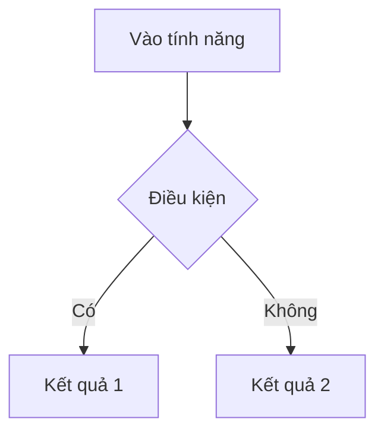

# BPRD: <Tên tính năng> – Giai đoạn <n>

> Business and Product Requirements Document
>
> **Cách dùng mẫu**: sao chép file, đặt tên `BPRD-<số>-<TenTinhNang>.md`, xóa mọi dòng gợi ý dạng `> 💡` khi viết xong. Mục không áp dụng thì ghi "Không áp dụng", không xóa số mục để giữ cấu trúc chung giữa các BPRD. Sau khi tạo: thêm vào [[Requirements-MOC]].
>
> **Nguyên tắc viết**
> - BPRD trả lời **vì sao và cái gì**; chi tiết hành vi từng màn và tiêu chí nghiệm thu nằm ở User Story, BPRD chỉ dẫn link.
> - Mọi mục quan trọng có **mã** để truy vết chéo: KPI `K/E/T`, quy tắc `BR`, tính năng `F`, quyết định `QD`.
> - Ngắn gọn, chỉ mô tả cái có. Con số chưa có thì ghi "Đặt baseline", điểm chưa chốt thì đưa vào mục 10, không viết mơ hồ trong thân tài liệu.

## 1. Thông tin tài liệu

| **Trường**      | **Nội dung**                                              |
| :-------------- | :-------------------------------------------------------- |
| Tên dự án       | <Tên tính năng> (version <x.y>)                           |
| Người phụ trách | <tên>                                                     |
| Phiên bản       | v1.0                                                      |
| Trạng thái      | Bản nháp / Đang review / Đã duyệt                         |
| Nhóm tham gia   | Product, Design, Dev (App, Backend), QA, <Nội dung>, <Kinh doanh> |
| Mức độ ưu tiên  | Cao / Trung bình / Thấp                                   |
| Hạn ra mắt      | <ngày hoặc mốc, ví dụ: trước Tết>                         |

## Nhật ký thay đổi

| Ngày cập nhật | Phiên bản | Người thực hiện | Nội dung thay đổi  |
| :------------ | :-------- | :-------------- | :----------------- |
| YYYY-MM-DD    | v1.0      | <tên>           | Khởi tạo tài liệu  |

---

## 2. Tổng quan kinh doanh

### 2.1. Vấn đề và cơ hội

> 💡 Mỗi vấn đề một gạch đầu dòng: **tên vấn đề in đậm** + bằng chứng (số liệu, phản hồi, link story bản cũ). Cơ hội trả lời: vì sao làm **bây giờ**.

**Vấn đề**

- **<Vấn đề 1>.** <Mô tả, bằng chứng>
- **<Vấn đề 2>.** <Mô tả, bằng chứng>

**Cơ hội**

- <Thời điểm, nhu cầu thị trường, mô hình kinh doanh mới, khả năng tái sử dụng>

### 2.2. Mục tiêu

**Mục tiêu kinh doanh**

- <Doanh thu, chuyển đổi, giữ chân>

**Mục tiêu sản phẩm**

- <Mỗi mục tiêu gắn với một vấn đề ở 2.1>

### 2.3. KPI

> 💡 Mỗi vấn đề ở 2.1 phải có ít nhất một chỉ số đo được. Tên sự kiện tracking ghi luôn ở đây để Dev gắn đúng.

> Chưa có số liệu nền thì ghi "Đặt baseline"; chốt mục tiêu sau <4> tuần chạy chính thức.

**KPI cốt lõi**

| **Mã**  | **Chỉ số** | **Định nghĩa / Cách tính** | **Mục tiêu** | **Tần suất** |
| :------ | :--------- | :------------------------- | :----------- | :----------- |
| **K01** |            |                            |              |              |

**Phễu chuyển đổi**

| **Bước** | **Sự kiện** | **Tỷ lệ theo dõi** | **Ngưỡng cảnh báo** |
| :------- | :---------- | :----------------- | :------------------ |
| 1.       | `<event>`   | — (đầu phễu)       | —                   |

**Gắn kết và chất lượng**

| **Mã**  | **Chỉ số** | **Định nghĩa** | **Mục tiêu** |
| :------ | :--------- | :------------- | :----------- |
| **E01** |            |                |              |

**Kỹ thuật và vận hành**

| **Mã**  | **Chỉ số**                  | **Mục tiêu** |
| :------ | :-------------------------- | :----------- |
| **T01** | Thời gian phản hồi (P95)    | < 2 giây     |
| **T02** | Tỷ lệ phiên không crash     | ≥ 99,5%      |

> Tất cả chỉ số tách theo: nền tảng (iOS/Android), trạng thái đăng nhập, phiên bản app, <chiều riêng của tính năng>.

### 2.4. Phạm vi

**Lộ trình** *(bỏ bảng này nếu tính năng chỉ có một giai đoạn)*

| **Giai đoạn** | **Nội dung** | **Trạng thái**          |
| :------------ | :----------- | :---------------------- |
| **GĐ1**       |              | Đang làm (tài liệu này) |

**Trong phạm vi**

- <Màn / luồng / cơ chế>

**Ngoài phạm vi**

- <Hạng mục> — <lý do hoặc giai đoạn sẽ làm>

---

## 3. Người dùng mục tiêu

### 3.1. Chân dung người dùng

> 💡 Tối đa 2–3 persona, mỗi persona một dòng: tên, tuổi, nghề + thói quen + điều họ cần + điều khiến họ trả tiền / quay lại.

- **<Tên> (<tuổi>, <nghề>)**: <mô tả>

### 3.2. Jobs-to-be-Done

- **JTBD 1**: Khi <hoàn cảnh>, tôi muốn <việc cần làm>, để <kết quả mong muốn>.

---

## 4. Yêu cầu nghiệp vụ

### 4.1. Luồng nghiệp vụ

> 💡 Một sơ đồ cho luồng chính, gồm cả nhánh lỗi / hủy. Luồng phụ phức tạp thì tách 4.1.1, 4.1.2.

### 4.2. Quy tắc nghiệp vụ

> 💡 Nhóm quy tắc theo chủ đề. Mỗi quy tắc một mã `BR-xx` + tên ngắn trong ngoặc. Quy tắc còn là đề xuất thì ghi "Đề xuất" và trỏ tới mục QD tương ứng.

**<Nhóm 1>**

- **BR-01 (<Tên ngắn>)**: <Quy tắc>

**<Nhóm 2>**

- **BR-02 (<Tên ngắn>)**: <Quy tắc>

---

## 5. Đặc tả tính năng

> 💡 Bảng là mục lục tính năng, không viết AC ở đây. Cột User Story trỏ tới story và US cụ thể; chưa có thì ghi "Chưa có, cần viết".

| **Mã**  | **Tính năng** | **Mô tả** | **User Story**             | **GĐ** | **Trạng thái** |
| :------ | :------------ | :-------- | :------------------------- | :----- | :------------- |
| **F01** |               |           | [[Story-<Ten>]] US-01      | GĐ1    | Có story       |

---

## 6. Thiết kế

Tone chủ đạo: <màu, mã màu chính>, theo Figma "<tên file>".

| **Màn** | **Figma / Prototype** | **User Story**         |
| :------ | :-------------------- | :--------------------- |
|         | [[<file>.html]]       | [[Story-<Ten>]] US-01  |

> <Ghi chú trạng thái còn thiếu thiết kế: rỗng, lỗi, đang tải, khóa nội dung…>

---

## 7. Khảo sát in-app

- <Khảo sát gì, ở đâu, đo KPI nào>, dùng khung chung tại [[BPRD-002-KhaoSatInApp]].
- Kế hoạch chi tiết: [[SVP-<MÃ>-<TenTinhNang>]] *(hoặc "Lập sau khi …")*.

---

## 8. Yêu cầu phi chức năng

- **Bảo mật và quyền riêng tư**: <dữ liệu cá nhân, nội dung trả phí, xác thực server>
- **Hiệu năng**: <khớp với nhóm T ở 2.3>
- **Offline và bộ nhớ đệm**: <dữ liệu nào lưu trên máy, ứng xử khi mất mạng>
- **Cấu hình từ server**: <những gì đổi được không cần cập nhật app>
- **Tracking**: Gắn sự kiện cho phễu ở 2.3; mỗi sự kiện kèm <tham số chung>.
- **Nội dung**: <ai duyệt, quy ước câu chữ, xưng hô>
- **Tương thích**: Theo mức tối thiểu chung của app Lịch Việt (Flutter, Android và iOS).

---

## 9. Trường hợp ngoại lệ

> 💡 Mỗi dòng: **tình huống** → ứng xử của app. Ưu tiên: mất mạng, lỗi server, hủy giữa chừng, dữ liệu thiếu / thay đổi, hết hạn quyền, thao tác lặp.

- **<Tình huống>**: <Ứng xử>

---

## 10. Cần quyết định

> 💡 Mọi điểm chưa chốt đều nằm ở đây, không rải trong tài liệu. Luôn có đề xuất của BA để người quyết định chỉ cần chọn.

| **Mã**    | **Nội dung** | **Phương án**     | **Đề xuất** | **Người quyết** | **Hạn** | **Trạng thái** |
| :-------- | :----------- | :---------------- | :---------- | :-------------- | :------ | :------------- |
| **QD-01** |              | **A.** … **B.** … | A, vì …     |                 |         | Chờ            |

---

## 11. Phụ thuộc và rủi ro

| **Loại**  | **Nội dung** | **Ảnh hưởng** | **Cách xử lý** |
| :-------- | :----------- | :------------ | :------------- |
| Phụ thuộc | <API, đội nội dung, thanh toán, tính năng khác> |  |  |
| Rủi ro    |              |               |                |

---

## 12. Kế hoạch ra mắt

- **Alpha (<thời gian>)**: <kiểm thử nội bộ gì>
- **Beta (<thời gian>)**: Mở cho <x%> người dùng, theo dõi <chỉ số>.
- **Chính thức**: Mở 100% <mốc>, truyền thông <kênh>.
- **Sau ra mắt**: Đánh giá KPI sau <4> tuần, chốt baseline, quyết định bước tiếp theo.

---

## 13. Definition of Done

- [ ] Đã chốt toàn bộ mục QD và cập nhật quy tắc liên quan.
- [ ] Thiết kế đã duyệt, gồm các trạng thái rỗng / lỗi / đang tải.
- [ ] Đủ user story cho F01 → F<n>; code pass toàn bộ tiêu chí nghiệm thu.
- [ ] Đã gắn đủ sự kiện tracking của phễu và các chỉ số ở 2.3.
- [ ] <Tiêu chí riêng: nội dung được duyệt, thanh toán sandbox, cấu hình server…>
