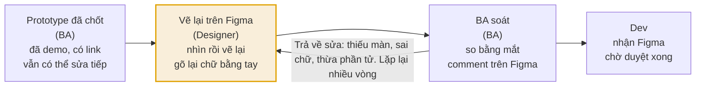
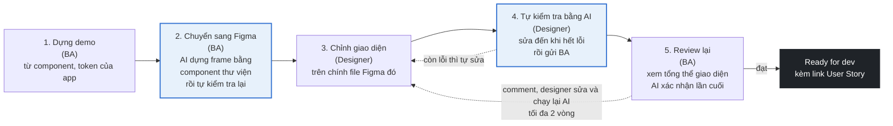

# Báo cáo luồng làm việc BA – Thiết kế – Dev

## Tóm tắt

Prototype của BA đã được chốt. Designer chỉ cần làm lại giao diện cho đẹp và đúng chuẩn, nhưng bản thiết kế vẫn **thiếu màn, sai chữ, thừa phần tử** nên phải sửa nhiều vòng.

**Nguyên nhân:** designer nhìn prototype rồi vẽ lại và gõ lại chữ bằng tay. BA đã nhắn dặn designer, nhưng việc vẽ lại thủ công vẫn để sót, vì không có gì tự đối chiếu bản thiết kế với prototype. BA soát bằng mắt rồi comment trên Figma, nhưng designer sửa theo comment vẫn hay sót hoặc sửa chưa đúng, nên phải soát lại nhiều vòng.

**Đề xuất luồng mới:**

1. **BA dựng demo từ component và token của app,** không tự đặt màu, cỡ chữ, khoảng cách riêng.
2. **Nhờ AI chuyển demo sang Figma.** AI đọc file demo trong repo và dựng lại trong Figma bằng component, variable có sẵn trong thư viện. Mỗi màn và mỗi trạng thái là một frame. Designer không phải vẽ lại.
3. **Designer chỉnh phần nhìn trên chính file Figma đó** theo quy tắc phạm vi. Muốn đổi nội dung thì comment đề xuất.
4. **Designer tự kiểm tra bằng AI trước khi gửi BA.** AI so Figma với demo và User Story, trả về danh sách lỗi. Designer sửa đến khi hết lỗi rồi mới gửi, kèm kết quả kiểm tra.
5. **BA review lại,** xem tổng thể giao diện. Cần sửa thêm thì comment để designer sửa. Trước khi giao dev, BA chạy AI một lần cuối để xác nhận. Tối đa 2 vòng.

## Luồng làm việc hiện nay

BA chốt luồng và nội dung bằng prototype HTML. Designer dựa vào đó để vẽ lại giao diện cho đẹp và đúng chuẩn trên Figma.

Giữa prototype và Figma không có danh sách đối chiếu nào, nên chỉ đến lúc BA soát thì lỗi mới lộ ra.

## Thực trạng

| Lỗi                       | Biểu hiện thường gặp                                                                                                                |
| -------------------------- | ---------------------------------------------------------------------------------------------------------------------------------------- |
| Thiếu                     | Thiếu phần tử trên màn như nút, icon, nhãn, text...                                                                              |
| Sửa theo comment bị sót | BA đã comment trên Figma nhưng designer sửa vẫn sót comment, sửa chưa đúng ý, hoặc sửa chỗ này làm lệch chỗ khác     |
| Sai chữ                   | Chữ thiếu từ, sai chính tả, khác cách viết so với prototype. Tên mục bị rút gọn hoặc lấy từ bản cũ                    |
| Thừa                      | Vẽ mới popup, màn đã có sẵn trong app thay vì dùng lại bản đã có. Cùng một popup, màn có nhiều phiên bản khác nhau |
| Chưa đúng chuẩn        | Màu, cỡ chữ, khoảng cách, bo góc mỗi màn một kiểu, các giá trị gần giống nhau nhưng không trùng                        |

## Nguyên nhân gốc

| # | Nguyên nhân                                                                                                                                                                                                                                                 | Dẫn đến                                                                                 |
| - | ------------------------------------------------------------------------------------------------------------------------------------------------------------------------------------------------------------------------------------------------------------- | ------------------------------------------------------------------------------------------ |
| 1 | Designer xem prototype rồi vẽ lại. Không có danh sách màn và trạng thái để đối chiếu                                                                                                                                                           | Thiếu màn, thiếu trạng thái                                                           |
| 2 | Chữ được gõ lại bằng tay hoặc chép từ file cũ                                                                                                                                                                                                      | Sai chữ, thiếu chữ                                                                      |
| 3 | BA có nhắn dặn designer, nhưng lời dặn nằm rải rác trong tin nhắn, không thành danh sách để designer tick lại trước khi gửi. Vẽ lại thủ công nên vẫn sót                                                                            | Vẫn thiếu sót dù đã dặn                                                             |
| 4 | BA soát bằng mắt nên mỗi vòng chỉ bắt được một phần lỗi                                                                                                                                                                                         | Lỗi lộ ra dần qua nhiều vòng                                                          |
| 5 | BA comment trên Figma, nhưng không có bước xác nhận từng comment đã sửa đúng. Comment được đánh dấu xong mà chưa ai kiểm lại, comment nằm rải rác trên nhiều frame dễ bị bỏ qua. Sửa chỗ này có khi làm lệch chỗ khác | Sửa theo comment vẫn sót hoặc chưa đúng, BA phải soát lại cả màn               |
| 6 | Prototype có thể còn được chỉnh sau khi đã gửi designer. Không có số phiên bản hay ghi chú thay đổi                                                                                                                                         | Designer làm theo bản cũ                                                                |
| 7 | Chưa có bộ token và component chung để tra. Không biết popup, màn nào đã có nên vẽ mới. Mỗi màn tự chọn màu, cỡ chữ, khoảng cách                                                                                                     | Thừa phiên bản popup, màn đã có. Chưa đúng chuẩn, phải chỉnh lại phần nhìn |

## Luồng làm việc đề xuất

BA dựng demo từ chính component và token của app rồi chuyển demo sang Figma. Designer chỉnh trên file Figma đó và tự kiểm tra bằng AI trước khi gửi BA. BA chỉ còn xem phần nhìn và chạy AI xác nhận lần cuối trước khi giao dev. Giao diện không còn phải vẽ lại từ đầu, nên chữ, phần tử và trạng thái giữ đúng như demo đã chốt.

*Màu xanh: bước mới thêm vào.*

Nội dung đi thẳng từ demo sang Figma, nên các lỗi thiếu, sai chữ và thừa gần như không còn. Việc của designer chuyển từ vẽ lại sang làm đẹp và chuẩn hóa.

| Bước                | Người làm | Việc cần làm                                                                                                                                                                                                                           | Đầu ra                                                        |
| --------------------- | ------------ | ----------------------------------------------------------------------------------------------------------------------------------------------------------------------------------------------------------------------------------------- | --------------------------------------------------------------- |
| 1. Dựng demo         | BA           | Dựng demo HTML chỉ bằng component và token của app. Dựng đủ các trạng thái: popup, thông báo, trống, lỗi, giới hạn                                                                                                       | Link demo có số phiên bản, danh sách màn và trạng thái |
| 2. Chuyển sang Figma | BA           | Đưa cho AI đường dẫn file demo trong repo và link file Figma của tính năng. AI dựng mỗi màn, mỗi trạng thái thành một frame, đặt tên theo mã (GY-01…), dùng thẳng component và variable trong thư viện Figma. Chuyển 1–2 màn mỗi lần. Chuyển xong AI tự so lại Figma với demo (đủ màn, trạng thái, chữ, phần tử), sửa hết chỗ sai rồi mới giao designer | File Figma có đủ frame, kèm kết quả kiểm tra sau khi chuyển |
| 3. Chỉnh giao diện  | Designer     | Chỉnh phần nhìn trên chính file đó, theo quy tắc phạm vi. Muốn đổi nội dung thì comment đề xuất                                                                                                                          | File Figma đã chỉnh                                        |
| 4. Tự kiểm tra bằng AI | Designer  | Cho AI so file Figma với demo và User Story. Từ vòng 2, đưa kèm danh sách comment của BA để AI kiểm tra từng comment đã sửa đúng chưa và tìm lỗi tương tự ở các frame khác. Sửa đến khi hết lỗi, chỉ còn danh sách component tạm `new-`                                                                                                                 | File Figma gửi BA, kèm kết quả kiểm tra AI                 |
| 5. Review lại       | BA           | Xem tổng thể giao diện, trả lời đề xuất của designer. Cần sửa thì comment. Trước khi giao dev, chạy AI một lần cuối để xác nhận                                                                                       | Comment gửi designer, hoặc "Ready for dev"                  |

**Nguyên tắc:**

- **Demo là nguồn đúng về nội dung:** chữ, phần tử, màn, trạng thái. Figma sau khi designer chỉnh là nguồn đúng về phần nhìn.
- **Demo và Figma dùng chung một bộ token và component.** Tên token trong demo trùng tên variable trong Figma, ví dụ `color/primary`, `space/16`.
- **Không vẽ lại, không gõ lại chữ.** Designer chỉnh trên frame đã chuyển sang.
- **Đề xuất thay vì tự đổi.** Designer thấy nên đổi nội dung thì comment, BA quyết.

## Điều kiện để áp dụng

Luồng mới chỉ chạy được khi đã có đủ 4 điều kiện sau.

| Điều kiện                              | Hiện trạng                                                                                                                                                             | Việc cần làm                                                                                                                                       |
| ----------------------------------------- | ------------------------------------------------------------------------------------------------------------------------------------------------------------------------ | ----------------------------------------------------------------------------------------------------------------------------------------------------- |
| Bộ token và component chung trên Figma | Đã có bộ chung cho toàn app (Variables, Text Styles, component), chưa cập nhật đủ                                                                              | Designer cập nhật cho đủ                                                                                                                          |
| Bộ component cho demo HTML               | Đã có bản đầu trong `prototype/design-system/`: token CSS, 11 component, trang danh mục `index.html`. Quy tắc cho AI ở `.agents/rules/demo-components.md` | Đồng bộ thêm mỗi khi designer cập nhật thư viện Figma                                                                                        |
| Chuyển demo sang Figma                   | Đã chọn cách nhờ AI chuyển qua Figma MCP. Claude đã kết nối Figma bằng tài khoản design@lichviet.org (Full seat, team Lich Viet)                          | Thử trên 1 tính năng. Chốt câu lệnh mẫu cho AI. Cấp quyền edit cho tài khoản kết nối AI chỉ trên file hoặc project của tính năng, file design chính để "can view" |
| Designer tự chạy được kiểm tra bằng AI | Chưa có                                                                                                                                                                 | Cấp cho designer công cụ AI kết nối được Figma (ví dụ Claude Code có Figma MCP). Đóng gói các hạng mục kiểm tra thành một skill dùng chung để designer và BA kiểm cùng một chuẩn. Hướng dẫn designer chạy lần đầu |

### Cách AI dùng component khi dựng demo

Có 2 cách cho AI dùng component của app:

|                            | A. AI đọc thẳng Figma mỗi lần dựng demo              | B. Đồng bộ component về repo một lần, AI dựng demo từ bản trong repo     |
| -------------------------- | ---------------------------------------------------------- | --------------------------------------------------------------------------------- |
| Tốc độ dựng demo       | Chậm hơn, mỗi lần phải đọc lại Figma               | Nhanh, đọc file có sẵn trong repo                                             |
| Độ ổn định            | Mỗi lần AI có thể dựng một component hơi khác nhau | Lần nào cũng dùng đúng một đoạn code                                     |
| Phụ thuộc                | Cần kết nối và quyền truy cập Figma mỗi lần        | Không cần Figma khi dựng demo                                                  |
| Chuyển sang Figma        | Tên lớp không cố định, AI khó biết lớp nào là component nào | Tên class cố định, AI biết chính xác dùng component nào trong thư viện Figma |
| Cập nhật khi Figma đổi | Tự có bản mới nhất                                    | Phải chạy bước đồng bộ                                                     |

**Đề xuất: dùng cách B, và dùng cách A cho bước đồng bộ.**

- Figma là nơi gốc của component. Designer chỉ sửa component trên Figma.
- Khi designer thêm hoặc sửa component, AI đọc Figma và cập nhật bộ component HTML trong repo, gồm file token CSS, các component và một trang danh mục để BA xem có những gì. Đây cũng là bước 4 "Hai phía khớp nhau" ở mục trên.
- Khi dựng demo, BA và AI chỉ dùng bộ component trong repo. Thêm một quy tắc cho AI trong `.agents/rules/`: dựng demo chỉ từ bộ component và token trong repo, thiếu thì tạo component tạm `new-`.

Với BA, cách này dễ dùng nhất: không phải mở Figma khi dựng demo, mở trang danh mục là biết có component nào, và demo nào cũng ra cùng một kiểu.

**Lưu ý khi nhờ AI chuyển demo sang Figma:**

- **Không cần plugin html.to.design.** Plugin chỉ chụp lại trang web thành lớp thường, chưa gắn component và variable, nên designer phải gắn lại. AI dựng thẳng bằng component và variable trong thư viện nên bỏ được bước gắn.
- **Đưa đường dẫn file trong repo, không đưa link web.** AI đọc mã nguồn demo, gồm cả CSS và token, nên chính xác hơn đọc qua link Vercel.
- **Trạng thái ẩn không cần mở sẵn.** Popup, thông báo, trạng thái sau thao tác đều có trong mã nguồn demo. AI tự tách mỗi trạng thái thành một frame.
- **AI dựng lại từ code, không chụp lại trang web.** Chữ, phần tử và bố cục giữ đúng, nhưng vài chi tiết nhỏ như bóng đổ, hiệu ứng có thể lệch. Phần này designer chỉnh ở bước 3.
- **Chuyển 1–2 màn mỗi lần.** Chuyển nguyên một trang dài cùng lúc dễ lệch.
- **Kiểm tra ngay trong bước chuyển.** Chuyển xong, AI so lại Figma với demo: đủ màn, trạng thái, chữ, phần tử. Sai thì sửa luôn rồi mới giao designer, để designer không chỉnh trên bản đã sai và lỗi không bị đẩy sang bước 4.
- **Quyền Figma.** Tài khoản Figma kết nối với AI phải có quyền edit trên file đích. Chỉ cấp quyền edit trên file hoặc project của tính năng, file design chính để "can view" để AI không sửa nhầm.

## Khi bộ component chưa có

Tính năng mới thường cần phần tử mà thư viện chưa có. BA không chờ designer làm component trước. BA vẫn dựng demo, nhưng theo 4 quy tắc:

1. **Tìm trước khi tạo.** Kiểm tra component hoặc biến thể có sẵn có dùng được không, kể cả khi phải đổi chữ hay icon. Chỉ tạo mới khi thật sự không có.
2. **Tạo mới vẫn dùng token.** Phần tử mới chỉ dùng màu, cỡ chữ, khoảng cách, bo góc có trong bộ token. Không đặt giá trị riêng.
3. **Đánh dấu là component tạm.** Đặt tên có tiền tố `new-` trong demo, ví dụ `new-rating-card`, và ghi vào danh sách component mới khi bàn giao (tên, dùng ở màn nào, có những trạng thái nào).
4. **Designer chuẩn hóa, không BA.** Designer thiết kế lại phần tử đó cho đúng chuẩn trên Figma và đưa vào thư viện. Sau đó component được bổ sung vào bộ component HTML, để lần sau BA dùng lại.

Khi kiểm tra bằng AI, mọi lớp không gắn với component trong thư viện sẽ bị báo. Lớp có tiền tố `new-` được tách riêng thành danh sách "component mới chờ chuẩn hóa", không tính là lỗi.

Bộ component vì vậy lớn dần theo từng tính năng. Giai đoạn đầu sẽ có nhiều component tạm, càng về sau càng ít.

### Sau khi designer chuẩn hóa component

**Không cần sửa lại demo của tính năng đó.** Demo đã xong việc của nó: là nguồn đúng về nội dung. Phần nhìn lúc này lấy theo Figma, và dev code theo Figma. Việc phải làm ở 3 chỗ:

| Chỗ                   | Việc cần làm                                                                                                                                                                         | Người làm                        |
| ---------------------- | --------------------------------------------------------------------------------------------------------------------------------------------------------------------------------------- | ----------------------------------- |
| Figma của tính năng | Thay lớp `new-` bằng component chính thức vừa đưa vào thư viện                                                                                                              | Designer                            |
| Bộ component HTML     | Thêm component mới để các demo sau dùng. Có thể cho AI đọc component trên Figma rồi sinh bản HTML, người duy trì bộ component chỉ cần kiểm lại                     | Người duy trì bộ component HTML |
| Demo của tính năng  | Chỉ sửa khi tính năng có thay đổi và phải chuyển lại sang Figma. Lúc đó đổi `new-` sang component chính thức trước khi chuyển, để không đưa bản tạm trở lại | BA                                  |

**AI rà soát lại theo 4 bước:**

1. **Không còn lớp tạm trong Figma.** AI tìm mọi lớp có tiền tố `new-` trong file của tính năng. Còn lớp nào thì báo tên lớp và frame.
2. **Thay component không làm hỏng nội dung.** AI chạy lại kiểm tra chữ, phần tử và trạng thái giữa Figma và demo, vì khi thay lớp dễ mất chữ hoặc mất trạng thái.
3. **Component mới đạt chuẩn thư viện.** AI kiểm tra component vừa thêm:
   - Chỉ dùng variable, không có giá trị gõ tay
   - Có đủ các trạng thái BA đã ghi trong danh sách component mới (ví dụ mặc định, đang bấm, vô hiệu)
   - Đặt tên theo quy ước và có mô tả
4. **Hai phía khớp nhau.** AI so component trên Figma với bản HTML vừa thêm: cùng token, cùng biến thể, cùng kích thước. Lệch thì báo để sửa bản HTML.

Kết quả rà soát là một danh sách theo 4 bước trên. Đạt hết thì BA xóa component đó khỏi danh sách "chờ chuẩn hóa".

## Quy tắc phạm vi của designer

| Được tự đổi                                         | Không được tự đổi                                  |
| --------------------------------------------------------- | --------------------------------------------------------- |
| Màu, font, cỡ chữ, khoảng cách, bo góc (theo token) | Chữ trên giao diện                                     |
| Icon, ảnh minh họa, hiệu ứng                          | Số lượng và thứ tự phần tử, mục trong danh sách |
| Cách sắp xếp bên trong một khối                     | Màn, popup, trạng thái, luồng bấm                    |

Muốn đổi ở cột phải thì designer để comment đề xuất trên Figma. BA quyết, sửa demo và User Story trước, sau đó designer mới sửa. Khi bàn giao, BA ghi kèm phần nào designer được tự do sáng tạo, ví dụ ảnh minh họa.

## Kiểm tra bằng AI

AI đọc file Figma, demo và User Story, rồi trả về danh sách lỗi theo từng frame. Designer chạy trước khi gửi BA để tự sửa hết lỗi. BA chạy lại một lần cuối trước khi giao dev. Cả hai dùng chung một skill kiểm tra nên ra cùng kết quả.

| Hạng mục                      | AI so cái gì                                                                          | Lỗi bắt được                                                                |
| ------------------------------- | --------------------------------------------------------------------------------------- | -------------------------------------------------------------------------------- |
| Đủ màn và trạng thái      | Danh sách màn và trạng thái với các frame trong Figma                            | Thiếu frame popup, thiếu trạng thái lỗi                                     |
| Chữ                            | Toàn bộ chữ trong Figma với chữ trong demo                                         | Thiếu từ, sai chính tả, tên mục bị rút gọn                              |
| Phần tử                       | Số lượng và thứ tự phần tử, mục trong danh sách                               | Danh sách thiếu mục hoặc có mục lạ                                        |
| Token và component             | Màu, chữ, khoảng cách có gắn variable không. Component có bị tách rời không | Màu gõ tay, component bị detach                                               |
| Phạm vi                        | Thay đổi của designer có vượt quy tắc phạm vi không                            | Thêm nút, đổi thứ tự khối                                                 |
| Trùng với cái đã có       | Popup, màn, khối mới với component và màn đã có trong thư viện               | Vẽ mới popup, màn đã có sẵn thay vì dùng lại                           |
| Comment của BA (từ vòng 2) | Từng comment với frame đã sửa. Lỗi trong comment với các frame khác             | Comment sửa chưa đúng. Cùng một lỗi sửa ở màn này, màn khác chưa sửa       |

AI không thay được mắt người ở phần thẩm mỹ. Vì lỗi nội dung đã được designer tự sửa, BA chỉ cần tập trung vào phần nhìn.

**Quy tắc xử lý comment:**

- Mỗi lỗi là một comment riêng, gắn đúng vào phần tử trên frame. Không gộp nhiều lỗi vào một comment.
- Designer sửa xong thì trả lời "đã sửa" trong comment, không tự đánh dấu resolve.
- Comment của BA chủ yếu về phần nhìn, vì lỗi nội dung designer đã tự sửa bằng AI.
- Designer sửa xong thì chạy lại AI, kèm danh sách comment của BA, để bắt lỗi phát sinh khi sửa và lỗi tương tự ở các frame khác, rồi mới gửi lại BA. Còn comment chưa trả lời thì chưa được gửi lại BA.
- Ở vòng sau, BA soát từng comment trên Figma. Đúng thì resolve.

## Checklist

### Designer trước khi gửi lại BA

- [ ] Chỉ chỉnh trên frame đã chuyển sang, không tạo frame vẽ lại
- [ ] Mọi thay đổi phần nhìn dùng token và component từ thư viện, không gõ giá trị tay, không detach component
- [ ] Popup, màn đã có trong app thì dùng lại bản trong thư viện, không vẽ mới
- [ ] Không đổi chữ, số phần tử, màn, trạng thái. Đề xuất để ở dạng comment
- [ ] Mọi component tạm (`new-`) đã được thiết kế chuẩn, đưa vào thư viện và báo BA để bổ sung vào bộ component HTML
- [ ] Đã chạy kiểm tra bằng AI và sửa hết lỗi. Gửi BA kèm kết quả kiểm tra
- [ ] Từ vòng 2: mọi comment của BA đã được trả lời "đã sửa", không tự resolve, đã chạy lại AI kèm danh sách comment để sửa cả lỗi tương tự ở các frame khác

### BA kiểm tra

- [ ] Kết quả kiểm tra AI designer gửi kèm không còn lỗi. Còn lỗi thì trả lại designer, chưa xem
- [ ] Xem lại tổng thể phần nhìn
- [ ] Trả lời các comment đề xuất của designer. Đồng ý thì sửa demo và User Story trước
- [ ] Gửi góp ý cho designer trong một lượt, mỗi lỗi một comment gắn đúng phần tử, tối đa 2 vòng
- [ ] Từ vòng 2: soát từng comment, đúng thì resolve
- [ ] Chạy AI một lần cuối, không còn lỗi thì gắn nhãn "Ready for dev" trên Figma, kèm link User Story

## Lộ trình, chỉ số và quyết định

Nên chạy thử trên 1 tính năng trước rồi mới áp dụng cho toàn bộ. Mốc thời gian là ước lượng, chờ sếp chốt.

1. **Tuần 1–2 – Nền tảng.** Designer hoàn thiện token và component chung trên Figma. Xuất token sang CSS. Dựng bộ component HTML cho demo. Đóng gói skill kiểm tra bằng AI, cài cho designer.
2. **Tuần 3 – Chạy thử.** BA dựng demo 1 tính năng từ component, nhờ AI chuyển sang Figma. Designer chỉnh và tự kiểm tra bằng AI, BA xem phần nhìn.
3. **Tuần 4 – Đánh giá.** So chỉ số, chỉnh quy trình, quyết định có áp dụng cho toàn bộ hay không.

**Chỉ số theo dõi** (đo mốc hiện tại từ 1–2 tính năng vừa làm xong):

| Chỉ số                                                             | Cách đo                             | Mục tiêu                              |
| -------------------------------------------------------------------- | ------------------------------------- | --------------------------------------- |
| Số vòng sửa mỗi tính năng                                      | Đếm số lần BA trả thiết kế về | Tối đa 2                              |
| Số lỗi thiếu, sai chữ, thừa ở lần kiểm tra đầu             | Đếm trong báo cáo AI              | Gần 0                                  |
| Thời gian designer làm mỗi màn                                   | Số giờ                              | Giảm so với mốc, vì không vẽ lại |
| Thời gian từ lúc demo chốt đến "Ready for dev"                 | Số ngày                             | Ngắn hơn mốc                         |
| Lỗi giao diện do thiết kế sai, phát hiện ở khâu dev hoặc QA | Bug gắn nhãn "lỗi thiết kế"      | Giảm so với mốc                      |

**Cần sếp quyết định:**

- [ ] Áp dụng luồng mới: BA dựng demo từ component, designer chỉnh trên Figma được chuyển sang và tự kiểm tra bằng AI trước khi gửi BA
- [ ] Cấp công cụ AI kết nối Figma cho designer, và quyền edit Figma cho AI trên file của tính năng
- [ ] Thời gian cho designer hoàn thiện bộ token và component chung (điều kiện bắt buộc)
- [ ] Người dựng và duy trì bộ component HTML cho demo
- [ ] Áp dụng quy tắc phạm vi cho designer
- [ ] Tính năng chạy thử và ngày bắt đầu
